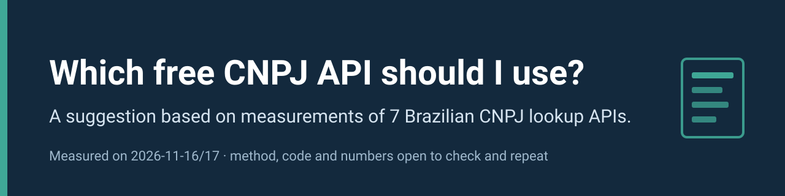

<p align="center">
  
</p>

# Free CNPJ API: which one to use?

**A measured comparison of 7 free Brazilian CNPJ lookup APIs** (BrasilAPI, Minha Receita,
ReceitaWS, CNPJá Open, CNPJ.ws, OpenCNPJ.org and OpenCNPJ.com), all serving Receita Federal
(Brazilian Federal Revenue) company registry data. Português: [README.md](README.md)

If you need to look up Brazilian companies by CNPJ (the company tax ID) from a system, spreadsheet
or script without paying, there are several free APIs and it is not obvious which one to use. This
repository offers a **suggestion based on measurements**: the same lookups were sent to all seven
APIs in the same period, and the results were compared. The table below gives a quick
recommendation by type of use. The numbers, the code and the method are published so that anyone
can check and repeat the measurement.

## Short answer

| If you need… | Suggestion | Measured basis (2026-11-16/17) |
|---|---|---|
| Single lookups, no key, most recent data | **Minha Receita** (S02) | Companies opened up to 2026-11-14 were already present on 2026-11-16. 0% HTTP 429 at up to 6,310 requests/min. Retry a 404 with the punctuated CNPJ (note 4). |
| High volume or commercial use | **OpenCNPJ.org** (S06) | Coverage 99.0% (n = 300). 0% HTTP 429 at up to 5,209 requests/min. The service FAQ allows commercial use. Data one monthly release behind (newest company: 2026-10-08). |
| The most complete record for one company | **CNPJá Open** (S04) | Relative completeness 99.8%, including IBGE code, e-mail and Simples/MEI. Limit of 5 requests/min per IP. HTTP 402 for 13 of 36 companies opened on 2026-11-01..14. |
| Lowest latency | **OpenCNPJ.com** (S07) | Latency p50 53 ms, p95 94 ms (n = 300). Data about two months behind (newest company: 2026-09-11). |
| A company opened **this week** | none of the free APIs measured | All of them depend on the monthly Receita Federal open-data release. The latest release was extracted on 2026-11-14 and published on 2026-11-16. |
| Tens of thousands of CNPJs at once | the Receita Federal open-data files, or your own Minha Receita instance | Not measured here. A design recommendation: it avoids depending on a public API's limits. |

BrasilAPI (S01) forwards CNPJ lookups to Minha Receita and returns the same data. Calling Minha
Receita directly avoids an intermediate layer and the HTTP 429 block that BrasilAPI applied to a
second burst of requests. Full reasoning per use case: [docs/ranking.md](docs/ranking.md).

> This is a suggestion, not a certification. It holds for the period measured (one night,
> 2026-11-16/17 UTC) and for small samples. Free tiers change without notice. Check the date
> before deciding.

## Results

| API | Coverage¹ | Relative completeness² | Newest opening date returned³ | Documented limit | Latency p50 / p95 | HTTP 429 at the pace used (pace) |
|---|---|---|---|---|---|---|
| [Minha Receita](docs/sources/S02-minhareceita.md) | 91.7% → 100% after retest⁴ | 90.7% | 2026-11-14 | none | 297 / 343 ms | 0.0% (60 req/min) |
| [BrasilAPI](docs/sources/S01-brasilapi.md) | 90.3% → 100% after retest⁴ | 90.5% | 2026-11-14 | not documented | 412 / 488 ms | 0.0% (60 req/min) |
| [OpenCNPJ.org](docs/sources/S06-opencnpj-org.md) | 99.0% | 92.4% | 2026-10-08 | no fixed quota | 496 / 673 ms | 0.0% (300 req/min) |
| [CNPJá Open](docs/sources/S04-cnpja-open.md) | 99.0% | 99.8% | 2026-11-10⁵ | 5 req/min per IP | 326 / 538 ms | 10.7% (5 req/min) |
| [OpenCNPJ.com](docs/sources/S07-opencnpj-com.md) | 99.0% | 91.8% | 2026-09-11 | 300 req/min per IP | 53 / 94 ms | 0.0% (120 req/min) |
| [ReceitaWS](docs/sources/S03-receitaws.md) | 99.0% | 93.0% | 2026-10-27⁶ | 3 req/min | 238 / 287 ms | 16.0% (3 req/min) |
| [CNPJ.ws](docs/sources/S05-cnpjws-public.md) | 99.1% (n = 226)⁷ | 96.7% | 2026-10-27⁷ | 3 req/min per IP | 374 / 15,967 ms | 11.0% (3 req/min) |

1. **Coverage:** CNPJs returned ÷ CNPJs with a conclusive answer (found, not found, or withheld on
   the free tier), over 300 sampled CNPJs; 297 of them exist. For the 99.0% rows the 95% confidence
   interval is 97.1–99.7%; differences of that size are not significant.
2. **Relative completeness:** of the 25 fields compared, the share the API fills among the fields
   that at least one API fills for that CNPJ. A field empty in every API does not count.
3. Most recent opening date among the companies the API returned in the freshness test
   (346 lookups of 343 distinct CNPJs, of which 298 exist).
4. 404 served from a stale CDN cache (a network of intermediate servers that stores answers):
   26 (BrasilAPI) and 22 (Minha Receita) of the 297 existing CNPJs. Requested in punctuated form
   (`12.345.678%2F0001-95`), all 42 were returned.
5. HTTP 402 ("only available in commercial api") for 13 of 36 companies opened on 2026-11-01..14.
6. The free tier only serves what is already in the provider's own cache ("not in cache").
7. The API degraded during the test: 32 of 258 CNPJs (12.4%) ended in HTTP 500/504 or timeout.
   Coverage uses the 226 CNPJs with a conclusive answer. The date is the newest in the API's own
   records; it also returned a company opened on 2026-11-06 whose record had no opening date.

req/min = requests per minute. "Pace used" is the maximum rate configured in the test for each
API: the documented or observed limit, or 60 req/min when no limit is known. With one request at a
time, OpenCNPJ.org reached 121.7 effective CNPJs/min, bounded by its own latency, not the 300
configured. p50 and p95 are latency
percentiles: half of the answers arrived within p50, and 95% within p95.

Full reports: [quality (wave 1)](results/wave1/REPORT.md) ·
[rate limits (wave 2)](results/wave2/REPORT.md) ·
[freshness and alphanumeric CNPJ](results/freshness/REPORT.md) ·
[per-field table](results/wave1/DATASHEET.md).

## How it was measured (summary)

- **Same lookups for all.** The same CNPJ list was sent to the seven APIs, in the same time window,
  by the same HTTP client, one request at a time per API, at the pace of each API's limit.
- **Same format.** Every answer was converted to a common 25-field schema, so that each field means
  the same thing for every API.
- **Agreement.** Each value was compared with the value held by the majority of the other APIs that
  have the field. There was no official answer key per CNPJ, so agreement measures consistency,
  not truth.
- **Freshness.** CNPJ base numbers are issued in increasing order. Building head-office CNPJs from
  the highest numbers yields a sample of recently opened companies without any external list.
- **Limits.** In a second stage, each API was queried at 1×, 2× and 4× its pace and in short
  bursts, with stop rules so as not to overload the providers.

Full method, metrics, field schema and threats to validity: [docs/methodology.md](docs/methodology.md).

## Limitations

- Exploratory study: one night of collection (2026-11-16/17, UTC), one client, one IP address.
- Small samples: 300 CNPJs for quality, 196 for limits, 346 lookups for freshness. Differences of a
  few percentage points fall within the confidence intervals.
- The quality sample comes from one organisation's registry, which is older and has more
  corporations (S.A.) than the national population of companies.
- Most APIs use the same monthly Receita Federal release; agreeing does not prove being correct.
- CNPJ.ws was unstable during the test; its numbers rest on less data.
- Limits were measured in short bursts. Daily quotas and hourly blocks were not tested.
- This repository publishes aggregate numbers only. Per-request files are not included, because
  the quality sample comes from a private registry.

## How to reproduce

Requirements: Python 3.11 or later and Docker (for the local MongoDB database that stores answers).

```bash
python -m venv .venv
.venv/Scripts/python -m pip install -e ".[dev,viz]"   # Linux/macOS: .venv/bin/python
.venv/Scripts/python -m pytest -q                      # offline tests of connectors and metrics
docker compose up -d                                   # MongoDB on 127.0.0.1:27017
.venv/Scripts/python scripts/00_smoke_sources.py       # one lookup against each API
```

- The freshness and alphanumeric-CNPJ tests use CNPJs generated by the code itself (steps 32 and
  33, seed 20261116) and can be repeated by anyone.
- The quality test needs a list of real CNPJs. The original list comes from a private registry and
  is not published; any list in the format described in the guide works.
- The per-API pages are generated without network access from `results/summary.json`:
  `python scripts/95_build_source_docs.py`.

Full step-by-step guide with the command for each stage: [docs/reproduce.md](docs/reproduce.md).
Respect each provider's limits when repeating the collection.

## How to connect to each API

Each API has a page with endpoint, authentication, limits, `curl`, Python and JavaScript examples,
error answers observed, the JSON path of each field and the issues observed.

| ID | API | Page | Endpoint |
|---|---|---|---|
| S01 | BrasilAPI | [en](docs/sources/S01-brasilapi.md) · [pt-BR](docs/pt-BR/sources/S01-brasilapi.md) | `https://brasilapi.com.br/api/cnpj/v1/{cnpj}` |
| S02 | Minha Receita | [en](docs/sources/S02-minhareceita.md) · [pt-BR](docs/pt-BR/sources/S02-minhareceita.md) | `https://minhareceita.org/{cnpj}` |
| S03 | ReceitaWS | [en](docs/sources/S03-receitaws.md) · [pt-BR](docs/pt-BR/sources/S03-receitaws.md) | `https://receitaws.com.br/v1/cnpj/{cnpj}` |
| S04 | CNPJá Open | [en](docs/sources/S04-cnpja-open.md) · [pt-BR](docs/pt-BR/sources/S04-cnpja-open.md) | `https://open.cnpja.com/office/{cnpj}` |
| S05 | CNPJ.ws (public API) | [en](docs/sources/S05-cnpjws-public.md) · [pt-BR](docs/pt-BR/sources/S05-cnpjws-public.md) | `https://publica.cnpj.ws/cnpj/{cnpj}` |
| S06 | OpenCNPJ.org | [en](docs/sources/S06-opencnpj-org.md) · [pt-BR](docs/pt-BR/sources/S06-opencnpj-org.md) | `https://api.opencnpj.org/{cnpj}` |
| S07 | OpenCNPJ.com | [en](docs/sources/S07-opencnpj-com.md) · [pt-BR](docs/pt-BR/sources/S07-opencnpj-com.md) | `https://kitana.opencnpj.com/cnpj/{cnpj}` |

Minimal example with the general-use suggestion and a fallback:

```python
import requests

def lookup_cnpj(cnpj: str) -> dict | None:
    """cnpj with 14 characters, no punctuation; validate the check digits first."""
    r = requests.get(f"https://minhareceita.org/{cnpj}", timeout=20)
    if r.status_code == 404:  # may be a stale cached 404: try the punctuated form
        punctuated = f"{cnpj[:2]}.{cnpj[2:5]}.{cnpj[5:8]}%2F{cnpj[8:12]}-{cnpj[12:]}"
        r = requests.get(f"https://minhareceita.org/{punctuated}", timeout=20)
    if r.status_code != 200:  # error or still 404: second source
        r = requests.get(f"https://api.opencnpj.org/{cnpj}", timeout=20)
    return r.json() if r.status_code == 200 else None
```

The two APIs use different field names; the machine-readable field map of every API is in
[catalog/field_map.yaml](catalog/field_map.yaml).

## Data

| What | Where |
|---|---|
| Every published number, machine-readable | [results/summary.json](results/summary.json) |
| Endpoints, limits and pace used per API | [catalog/sources.yaml](catalog/sources.yaml) |
| Documented facts per provider (maintainer, terms, data origin), with links | [catalog/source_profiles.yaml](catalog/source_profiles.yaml) |
| JSON path of each field in each API | [catalog/field_map.yaml](catalog/field_map.yaml) |
| Code that converts each answer to the common schema | [src/cnpjbench/connectors/](src/cnpjbench/connectors/) |
| Summary for AI assistants and search engines | [llms.txt](llms.txt) |

## Related projects

This repository measures APIs maintained by other people and does not replace them. The services
measured are [BrasilAPI](https://github.com/BrasilAPI/BrasilAPI),
[Minha Receita](https://codeberg.org/cuducos/minha-receita),
[OpenCNPJ.org](https://github.com/Hitmasu/OpenCNPJ),
[OpenCNPJ.com](https://github.com/opencaramelo/opencnpj),
[ReceitaWS](https://receitaws.com.br), [CNPJá](https://cnpja.com) and [CNPJ.ws](https://www.cnpj.ws).
Survey of similar repositories (APIs, open-data pipelines, validators and lists):
[docs/similar-repositories.md](docs/similar-repositories.md).

## License and citation

- Code and texts: MIT license ([LICENSE](LICENSE)), holder andw87.
- The data returned by each API belongs to its provider and is subject to that provider's terms of
  use. API names are trademarks of their respective owners and appear here for identification only.
- To cite: [CITATION.cff](CITATION.cff). GitHub uses this file to show the "Cite this repository"
  option.

Corrections and new measurements are welcome through issues or pull requests.
