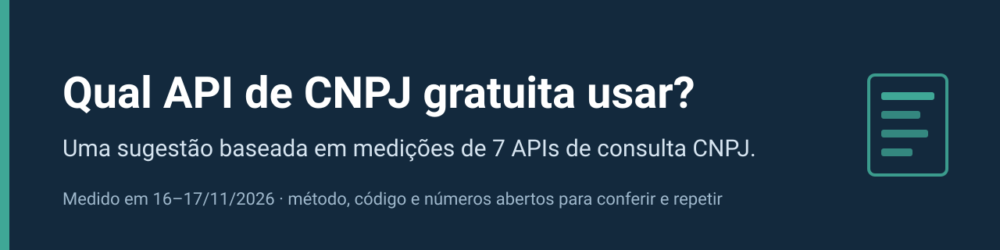

<p align="center">
  
</p>

# API de CNPJ gratuita: qual usar?

**Comparação medida de 7 APIs gratuitas de consulta CNPJ** (BrasilAPI, Minha Receita, ReceitaWS,
CNPJá Open, CNPJ.ws, OpenCNPJ.org e OpenCNPJ.com), todas com dados da Receita Federal.
English: [README.en.md](README.en.md)

Se você precisa consultar empresas pelo CNPJ em um sistema, planilha ou script e não quer pagar por
isso, há várias APIs gratuitas e não é óbvio qual usar. Este repositório oferece uma **sugestão
baseada em medições**: as mesmas consultas foram enviadas às sete APIs, no mesmo período, e os
resultados foram comparados. A tabela abaixo dá uma recomendação rápida por tipo de uso. Os números,
o código e o método estão publicados para que qualquer pessoa possa conferir e repetir a medição.

## Resposta curta

| Se você precisa de… | Sugestão | Base medida (16–17/11/2026) |
|---|---|---|
| Consulta individual, sem chave, com os dados mais recentes | **Minha Receita** (S02) | Empresas abertas até 14/11/2026 já estavam presentes em 16/11/2026. 0% de HTTP 429 a até 6.310 requisições/min. Repita um 404 com o CNPJ pontuado (nota 4). |
| Volume alto ou uso comercial | **OpenCNPJ.org** (S06) | Cobertura de 99,0% (n = 300). 0% de HTTP 429 a até 5.209 requisições/min. O FAQ do serviço permite uso comercial. Dados uma publicação mensal atrás (empresa mais recente: 08/10/2026). |
| O cadastro mais completo de uma empresa | **CNPJá Open** (S04) | Completude relativa de 99,8%, com código IBGE, e-mail e Simples/MEI. Limite de 5 requisições/min por IP. HTTP 402 para 13 de 36 empresas abertas em 01–14/11/2026. |
| Menor latência | **OpenCNPJ.com** (S07) | Latência p50 de 53 ms e p95 de 94 ms (n = 300). Dados cerca de dois meses atrás (empresa mais recente: 11/09/2026). |
| Uma empresa aberta **nesta semana** | nenhuma API gratuita medida | Todas dependem da base mensal de dados abertos da Receita Federal. A base mais recente foi extraída em 14/11/2026 e publicada em 16/11/2026. |
| Dezenas de milhares de CNPJs de uma vez | arquivos de dados abertos da Receita Federal, ou uma instância própria da Minha Receita | Não medido aqui. É uma recomendação de desenho: evita depender dos limites de uma API pública. |

A BrasilAPI (S01) repassa a consulta de CNPJ para a Minha Receita e devolve os mesmos dados. Chamar
a Minha Receita diretamente evita uma camada intermediária e o bloqueio por HTTP 429 que a BrasilAPI
aplicou a uma segunda rajada de requisições. Justificativa completa por caso de uso:
[docs/pt-BR/ranking.md](docs/pt-BR/ranking.md).

> Esta é uma sugestão, não uma certificação. Ela vale para o período medido (uma noite,
> 16–17/11/2026, UTC) e para amostras pequenas. Planos gratuitos mudam sem aviso. Confira a data
> antes de decidir.

## Resultados

| API | Cobertura¹ | Completude relativa² | Abertura mais recente retornada³ | Limite documentado | Latência p50 / p95 | HTTP 429 no ritmo usado (ritmo) |
|---|---|---|---|---|---|---|
| [Minha Receita](docs/pt-BR/sources/S02-minhareceita.md) | 91,7% → 100% após reteste⁴ | 90,7% | 14/11/2026 | nenhum | 297 / 343 ms | 0,0% (60 req/min) |
| [BrasilAPI](docs/pt-BR/sources/S01-brasilapi.md) | 90,3% → 100% após reteste⁴ | 90,5% | 14/11/2026 | não documentado | 412 / 488 ms | 0,0% (60 req/min) |
| [OpenCNPJ.org](docs/pt-BR/sources/S06-opencnpj-org.md) | 99,0% | 92,4% | 08/10/2026 | sem cota fixa | 496 / 673 ms | 0,0% (300 req/min) |
| [CNPJá Open](docs/pt-BR/sources/S04-cnpja-open.md) | 99,0% | 99,8% | 10/11/2026⁵ | 5 req/min por IP | 326 / 538 ms | 10,7% (5 req/min) |
| [OpenCNPJ.com](docs/pt-BR/sources/S07-opencnpj-com.md) | 99,0% | 91,8% | 11/09/2026 | 300 req/min por IP | 53 / 94 ms | 0,0% (120 req/min) |
| [ReceitaWS](docs/pt-BR/sources/S03-receitaws.md) | 99,0% | 93,0% | 27/10/2026⁶ | 3 req/min | 238 / 287 ms | 16,0% (3 req/min) |
| [CNPJ.ws](docs/pt-BR/sources/S05-cnpjws-public.md) | 99,1% (n = 226)⁷ | 96,7% | 27/10/2026⁷ | 3 req/min por IP | 374 / 15.967 ms | 11,0% (3 req/min) |

1. **Cobertura:** CNPJs retornados ÷ CNPJs com resposta conclusiva (encontrado, não encontrado ou
   retido no plano gratuito), em 300 CNPJs sorteados; 297 deles existem. Nas linhas com 99,0%, o
   intervalo de confiança de 95% é 97,1–99,7%; diferenças dessa ordem não são significativas.
2. **Completude relativa:** dos 25 campos comparados, a proporção que a API preenche entre os campos
   que pelo menos uma API preenche para aquele CNPJ. Um campo vazio em todas as APIs não conta.
3. Data de abertura mais recente entre as empresas que a API retornou no teste de frescor
   (346 consultas em 343 CNPJs distintos, dos quais 298 existem).
4. 404 servido de cache antigo da CDN (rede de servidores intermediários que guarda respostas):
   26 (BrasilAPI) e 22 (Minha Receita) dos 297 CNPJs existentes. Pedidos na forma pontuada
   (`12.345.678%2F0001-95`), os 42 foram retornados.
5. HTTP 402 ("only available in commercial api") para 13 de 36 empresas abertas em 01–14/11/2026.
6. O plano gratuito só serve o que já está no cache próprio do provedor ("not in cache").
7. A API degradou durante o teste: 32 de 258 CNPJs (12,4%) terminaram em HTTP 500/504 ou tempo
   esgotado. A cobertura usa os 226 CNPJs com resposta conclusiva. A data é a mais recente nos
   registros da própria API; ela também retornou uma empresa aberta em 06/11/2026 cujo registro não
   trazia data de abertura.

req/min = requisições por minuto. "Ritmo usado" é o ritmo máximo configurado no teste para cada
API: o limite documentado ou observado, ou 60 req/min quando não há limite conhecido. Com uma
requisição por vez, a OpenCNPJ.org ficou em 121,7 CNPJs/min efetivos, limitada pela própria
latência, e não nos 300 configurados. p50 e p95 são os
percentis 50 e 95 da latência: metade das respostas chegou em até p50, e 95% em até p95.

Relatórios completos: [qualidade (onda 1)](results/wave1/REPORT.pt-BR.md) ·
[limites de requisição (onda 2)](results/wave2/REPORT.pt-BR.md) ·
[frescor e CNPJ alfanumérico](results/freshness/REPORT.pt-BR.md) ·
[tabela por campo](results/wave1/DATASHEET.md).

## Como foi medido (resumo)

- **Mesmas consultas para todas.** A mesma lista de CNPJs foi enviada às sete APIs, na mesma
  janela de tempo, pelo mesmo cliente HTTP, uma requisição por vez por API, no ritmo do limite de
  cada uma.
- **Mesmo formato.** Cada resposta foi convertida para um esquema comum de 25 campos, para que cada
  campo signifique a mesma coisa em todas as APIs.
- **Concordância.** Cada valor foi comparado com o valor da maioria das outras APIs que têm o campo.
  Não houve gabarito oficial por CNPJ, então concordância mede consistência, não verdade.
- **Frescor.** Os números-base de CNPJ são emitidos em ordem crescente. Montando CNPJs de matriz a
  partir dos números mais altos, obtém-se uma amostra de empresas recém-abertas sem lista externa.
- **Limites.** Em uma segunda etapa, cada API foi consultada a 1×, 2× e 4× o seu ritmo e em
  rajadas curtas, com regras de parada para não sobrecarregar os provedores.

Método completo, métricas, esquema de campos e ameaças à validade:
[docs/pt-BR/methodology.md](docs/pt-BR/methodology.md).

## Limitações

- Estudo exploratório: uma noite de coleta (16–17/11/2026, UTC), um cliente, um endereço IP.
- Amostras pequenas: 300 CNPJs para qualidade, 196 para limites, 346 consultas para frescor.
  Diferenças de poucos pontos percentuais ficam dentro dos intervalos de confiança.
- A amostra de qualidade vem do cadastro de uma única organização, mais antigo e com mais
  sociedades anônimas que o conjunto nacional de empresas.
- A maioria das APIs usa a mesma base mensal da Receita Federal; concordar não prova estar correto.
- A CNPJ.ws estava instável durante o teste; seus números se apoiam em menos dados.
- Os limites foram medidos em rajadas curtas. Cotas diárias e bloqueios por hora não foram testados.
- Este repositório publica só números agregados. Os arquivos por requisição não estão incluídos,
  porque a amostra de qualidade vem de um cadastro privado.

## Como reproduzir

Requisitos: Python 3.11 ou mais recente e Docker (para o banco MongoDB local que guarda as respostas).

```bash
python -m venv .venv
.venv/Scripts/python -m pip install -e ".[dev,viz]"   # Linux/macOS: .venv/bin/python
.venv/Scripts/python -m pytest -q                      # testes offline dos conectores e das métricas
docker compose up -d                                   # MongoDB em 127.0.0.1:27017
.venv/Scripts/python scripts/00_smoke_sources.py       # uma consulta a cada API
```

- O teste de frescor e o teste de CNPJ alfanumérico usam CNPJs gerados pelo próprio código
  (passos 32 e 33, semente 20261116) e podem ser repetidos por qualquer pessoa.
- O teste de qualidade precisa de uma lista de CNPJs reais. A lista original vem de um cadastro
  privado e não é publicada; qualquer lista no formato descrito no guia serve.
- As fichas por API são geradas sem acesso à rede a partir de `results/summary.json`:
  `python scripts/95_build_source_docs.py`.

Passo a passo completo, com os comandos de cada etapa: [docs/pt-BR/reproduce.md](docs/pt-BR/reproduce.md).
Respeite os limites de cada provedor ao repetir a coleta.

## Como conectar a cada API

Cada API tem uma ficha com endpoint, autenticação, limites, exemplos em `curl`, Python e JavaScript,
respostas de erro observadas, caminho JSON de cada campo e problemas observados.

| ID | API | Ficha | Endpoint |
|---|---|---|---|
| S01 | BrasilAPI | [pt-BR](docs/pt-BR/sources/S01-brasilapi.md) · [en](docs/sources/S01-brasilapi.md) | `https://brasilapi.com.br/api/cnpj/v1/{cnpj}` |
| S02 | Minha Receita | [pt-BR](docs/pt-BR/sources/S02-minhareceita.md) · [en](docs/sources/S02-minhareceita.md) | `https://minhareceita.org/{cnpj}` |
| S03 | ReceitaWS | [pt-BR](docs/pt-BR/sources/S03-receitaws.md) · [en](docs/sources/S03-receitaws.md) | `https://receitaws.com.br/v1/cnpj/{cnpj}` |
| S04 | CNPJá Open | [pt-BR](docs/pt-BR/sources/S04-cnpja-open.md) · [en](docs/sources/S04-cnpja-open.md) | `https://open.cnpja.com/office/{cnpj}` |
| S05 | CNPJ.ws (API pública) | [pt-BR](docs/pt-BR/sources/S05-cnpjws-public.md) · [en](docs/sources/S05-cnpjws-public.md) | `https://publica.cnpj.ws/cnpj/{cnpj}` |
| S06 | OpenCNPJ.org | [pt-BR](docs/pt-BR/sources/S06-opencnpj-org.md) · [en](docs/sources/S06-opencnpj-org.md) | `https://api.opencnpj.org/{cnpj}` |
| S07 | OpenCNPJ.com | [pt-BR](docs/pt-BR/sources/S07-opencnpj-com.md) · [en](docs/sources/S07-opencnpj-com.md) | `https://kitana.opencnpj.com/cnpj/{cnpj}` |

Exemplo mínimo com a sugestão de uso geral e uma alternativa:

```python
import requests

def consulta_cnpj(cnpj: str) -> dict | None:
    """cnpj com 14 caracteres, sem pontuação; valide os dígitos verificadores antes."""
    r = requests.get(f"https://minhareceita.org/{cnpj}", timeout=20)
    if r.status_code == 404:  # pode ser um 404 antigo em cache: tente a forma pontuada
        pontuado = f"{cnpj[:2]}.{cnpj[2:5]}.{cnpj[5:8]}%2F{cnpj[8:12]}-{cnpj[12:]}"
        r = requests.get(f"https://minhareceita.org/{pontuado}", timeout=20)
    if r.status_code != 200:  # erro ou ainda 404: segunda fonte
        r = requests.get(f"https://api.opencnpj.org/{cnpj}", timeout=20)
    return r.json() if r.status_code == 200 else None
```

As duas APIs usam nomes de campo diferentes; o mapa de campos de cada API, legível por máquina,
está em [catalog/field_map.yaml](catalog/field_map.yaml).

## Dados

| O quê | Onde |
|---|---|
| Todos os números publicados, legíveis por máquina | [results/summary.json](results/summary.json) |
| Endpoints, limites e ritmo usado por API | [catalog/sources.yaml](catalog/sources.yaml) |
| Fatos documentados por provedor (mantenedor, termos, origem dos dados), com links | [catalog/source_profiles.yaml](catalog/source_profiles.yaml) |
| Caminho JSON de cada campo em cada API | [catalog/field_map.yaml](catalog/field_map.yaml) |
| Código que converte cada resposta para o esquema comum | [src/cnpjbench/connectors/](src/cnpjbench/connectors/) |
| Resumo para assistentes de IA e buscadores | [llms.txt](llms.txt) |

## Projetos relacionados

Este repositório mede APIs mantidas por outras pessoas e não as substitui. Os serviços medidos são
[BrasilAPI](https://github.com/BrasilAPI/BrasilAPI),
[Minha Receita](https://codeberg.org/cuducos/minha-receita),
[OpenCNPJ.org](https://github.com/Hitmasu/OpenCNPJ),
[OpenCNPJ.com](https://github.com/opencaramelo/opencnpj),
[ReceitaWS](https://receitaws.com.br), [CNPJá](https://cnpja.com) e [CNPJ.ws](https://www.cnpj.ws).
Levantamento de repositórios semelhantes (APIs, bases de dados abertos, validadores e listas):
[docs/pesquisa-repositorios-similares.md](docs/pesquisa-repositorios-similares.md).

## Licença e citação

- Código e textos: licença MIT ([LICENSE](LICENSE)), titular andw87.
- Os dados retornados por cada API pertencem aos respectivos provedores e seguem os termos de uso
  de cada um. Os nomes das APIs são marcas dos respectivos titulares e aparecem aqui só para
  identificação.
- Para citar: [CITATION.cff](CITATION.cff). O GitHub usa esse arquivo para mostrar a opção
  "Cite this repository".

Correções e novas medições são bem-vindas por issue ou pull request.
