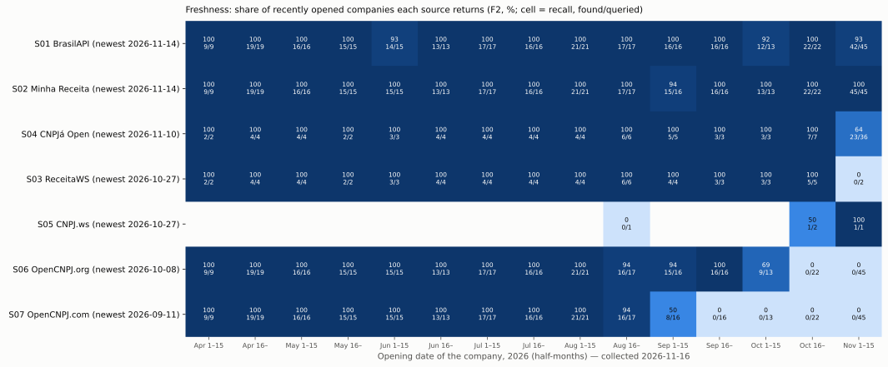

# Qual API de CNPJ gratuita usar: sugestão por caso de uso

English: [../ranking.md](../ranking.md) · Método: [methodology.md](methodology.md) ·
Números: [results/summary.json](../../results/summary.json)

> Sugestão baseada em uma única medição exploratória (16–17/11/2026, UTC). Planos gratuitos mudam
> sem aviso; confira a data antes de usar esta ordem como base de uma decisão.

## Resposta curta
Para a maioria das integrações que consultam um CNPJ por vez, a sugestão é a **Minha Receita
(S02)**: teve os dados mais recentes entre as sete APIs e não respondeu HTTP 429 em nenhuma etapa.
Repita qualquer 404 com o CNPJ pontuado, porque a CDN dela guardou 404 antigos para 7,4% dos CNPJs
existentes. Use a **OpenCNPJ.org (S06)** como segunda fonte, ou como fonte principal quando
precisar de milhares de consultas por minuto ou de permissão explícita para uso comercial. Para
processar dezenas de milhares de CNPJs, a sugestão (não medida aqui) é baixar a base mensal: os
arquivos oficiais da Receita Federal, o conjunto de dados da OpenCNPJ.org ou uma instância própria
da Minha Receita.

## Ordem sugerida para uso geral
Critério: uso gratuito, sem chave, uma aplicação consultando um CNPJ por vez. A ordem pesa, nesta
sequência, frescor dos dados, ausência de bloqueio por limite, cobertura e completude. O índice
composto pré-registrado (QI) não decide a ordem porque não inclui frescor
([methodology.md](methodology.md), §5.5).

| # | API | Evidência a favor | Principal ressalva |
|---|---|---|---|
| 1 | **S02 Minha Receita** | Base de 2026-11 no ar 2 dias após a publicação; 45 de 45 empresas abertas em 01–14/11/2026 retornadas. Sem chave; 0% de HTTP 429 a até 6.310 req/min. Código aberto e auto-hospedável. | A CDN serviu 404 antigos para 22 de 297 CNPJs existentes (7,4%); a forma pontuada `12.345.678%2F0001-95` os resolve. Capital social acima de R$ 16.777.216 é arredondado. Não retorna e-mail. |
| 2 | **S06 OpenCNPJ.org** | Cobertura de 99,0%. 0% de HTTP 429 a até 5.209 req/min. Uso comercial permitido pelo FAQ. Base completa para download. Retorna e-mail e telefones. | Uma publicação mensal atrás (empresa mais recente: 08/10/2026). Não retorna código IBGE. Não valida o CNPJ de entrada (dígito errado → 404). |
| 3 | **S01 BrasilAPI** | Mesmos dados e mesmo frescor da S02, porque repassa a consulta para ela. | Os mesmos 404 antigos em cache (26 de 297, 8,8%), por outra região da CDN. HTTP 429 para 100% de uma segunda rajada sem ritmo. Depende da disponibilidade da S02. Chamar a S02 diretamente evita essas três ressalvas. |
| 4 | **S04 CNPJá Open** | Maior completude relativa (99,8%), com código IBGE, e-mail e Simples/MEI preenchidos em 100% dos registros. | 5 req/min por IP, com 10,7% de HTTP 429 mesmo nesse ritmo. HTTP 402 para 13 de 36 empresas abertas em 01–14/11/2026 no plano gratuito. |
| 5 | **S07 OpenCNPJ.com** | Menor latência (p50 53 ms, p95 94 ms). Limite documentado de 300 req/min. | Cerca de dois meses atrás (empresa mais recente: 11/09/2026). Não retorna porte nem código IBGE. Sem licença de reutilização. |
| 6 | **S03 ReceitaWS** | Cobertura de 99,0% das empresas existentes da amostra. | 3 req/min; 2,5 CNPJs/min efetivos. O plano gratuito só serve o próprio cache ("not in cache"). Os termos proíbem uso comercial. |
| 7 | **S05 CNPJ.ws** | Retorna inscrições estaduais, que nenhuma outra API do estudo retorna. | 3 req/min; 1,4 CNPJ/min efetivo. Degradada durante o teste (12,4% de erros, latência p95 de 16 s). Os termos proíbem uso comercial. |

Empates: a cobertura de S03 a S07 (99,0–99,1%) é estatisticamente indistinguível (intervalo de 95%
de 97,1–99,7% para 297 de 300). Diferenças de concordância abaixo de 1 ponto percentual não são
significativas com n = 297.

## Por necessidade
| Necessidade | Sugestão | Evidência |
|---|---|---|
| Empresa aberta neste mês | S02 (ou S01) | 45 de 45 empresas abertas em 01–14/11/2026 retornadas pela S02; S06 e S07 retornaram 0 de 45 |
| Empresa aberta **nesta semana** | nenhuma das APIs gratuitas | Todas são limitadas pela base mensal da Receita Federal (extraída no 2º sábado do mês e publicada 1–3 dias depois). Uma empresa aberta em 16/11/2026 aparece no mínimo por volta de 14/12/2026 |
| Milhares de consultas por minuto | S06, ou a S02 auto-hospedada, ou os arquivos de dados abertos | S06: 0% de HTTP 429 a 5.209 req/min; S02: 0% a 6.310 req/min, em rajadas curtas |
| Registro individual mais completo | S04, a até 5 req/min | completude relativa de 99,8% |
| E-mail da empresa | S03 a S07 | preenchido em 79% dos registros em todas elas; S01 e S02 não retornam e-mail |
| Código IBGE do município | S01, S02, S04, S05 | S03, S06 e S07 não retornam |
| Capital social exato | qualquer uma, exceto S01 e S02 acima de R$ 16.777.216 | 26 de 39 valores acima desse limiar diferem das outras APIs; abaixo dele, 0 de 236 |
| Produto comercial | S06 (os termos permitem); S01 e S02 (código MIT; nenhum termo de uso da API encontrado) | os termos da S03 e da S05 proíbem uso comercial; os da S04 não foram confirmados para o plano gratuito |
| CNPJ alfanumérico na entrada (desde julho de 2026) | S01, S02, S03, S04, S05 e S07 aceitam e validam o formato | a S06 não valida a entrada (sonda F4) |
| Baixa latência | S07 (p50 53 ms); S02 (p50 297 ms na onda 1, 31 ms quando a resposta já estava em cache) | onda 1 e onda 2 |

## Como o frescor funciona
1. A Receita Federal publica o cadastro completo como dados abertos uma vez por mês. A extração
   ocorre no 2º sábado do mês, e os arquivos aparecem 1–3 dias depois. A base de 2026-11 foi
   extraída em 14/11/2026 e publicada em 16/11/2026.
2. Cada API carrega essa publicação no próprio calendário:
   - Minha Receita: base de 2026-11 no ar em 16/11/2026, 2 dias após a publicação.
   - OpenCNPJ.org: base de 2026-10 (publicada em 13/10/2026) carregada em 01/11/2026.
   - OpenCNPJ.com: calendário não documentado; empresa mais recente retornada abriu em 11/09/2026.
3. CNPJá e CNPJ.ws declaram defasagem máxima de 45 dias. A CNPJá retém parte das empresas recém-abertas
   no plano gratuito.
4. Nenhuma API gratuita medida retornou empresa aberta depois da extração mais recente (14/11/2026).



## Padrão de integração sugerido
```
consulta(cnpj):
  validar os dígitos verificadores localmente (formatos numérico e alfanumérico)
  r = GET https://minhareceita.org/{cnpj}
  se r == 404: r = GET https://minhareceita.org/{12.345.678%2F0001-95}   # evita o 404 antigo em cache
  se r for 5xx, tempo esgotado ou ainda 404: r = GET https://api.opencnpj.org/{cnpj}
  guardar o resultado no seu sistema; atualizar uma vez por mês
```
Para enriquecer dezenas de milhares de CNPJs ou mais, não percorra uma API pública em laço. Baixe a
base mensal: os arquivos oficiais, o conjunto de dados da OpenCNPJ.org ou uma instância própria da
Minha Receita.
