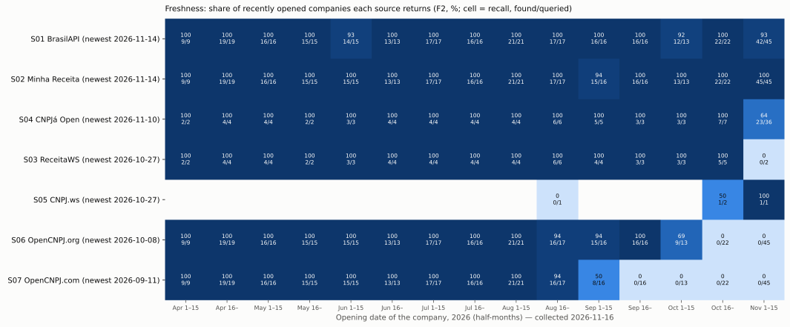

# Which free CNPJ API to use: suggestion by use case

Português: [pt-BR/ranking.md](pt-BR/ranking.md) · Method: [methodology.md](methodology.md) ·
Numbers: [results/summary.json](../results/summary.json)

> Suggestion based on a single exploratory measurement (2026-11-16/17, UTC). Free tiers change
> without notice; check the date before basing a decision on this order.

## Short answer
For most integrations that look up one CNPJ at a time, the suggestion is **Minha Receita (S02)**:
it had the most recent data of the seven APIs and answered no HTTP 429 at any stage. Retry any 404
with the punctuated CNPJ, because its CDN kept stale 404s for 7.4% of the existing CNPJs. Use
**OpenCNPJ.org (S06)** as a second source, or as the main source when you need thousands of lookups
per minute or explicit permission for commercial use. To process tens of thousands of CNPJs, the
suggestion (not measured here) is to download the monthly release: the official Receita Federal
files, the OpenCNPJ.org dataset or your own Minha Receita instance.

## Suggested order for general use
Criterion: free use, no key, one application looking up one CNPJ at a time. The order weighs, in
this sequence, data freshness, absence of rate-limit blocking, coverage and completeness. The
pre-registered composite index (QI) does not decide the order because it has no freshness term
([methodology.md](methodology.md), §5.5).

| # | API | Evidence for | Main caveat |
|---|---|---|---|
| 1 | **S02 Minha Receita** | 2026-11 release online 2 days after publication; 45 of 45 companies opened on 2026-11-01..14 returned. No key; 0% HTTP 429 at up to 6,310 req/min. Open source and self-hostable. | The CDN served stale 404s for 22 of 297 existing CNPJs (7.4%); the punctuated form `12.345.678%2F0001-95` resolves them. Share capital above R$ 16,777,216 is rounded. No e-mail. |
| 2 | **S06 OpenCNPJ.org** | Coverage 99.0%. 0% HTTP 429 at up to 5,209 req/min. Commercial use allowed by its FAQ. Full dataset downloadable. Returns e-mail and phones. | One monthly release behind (newest company: 2026-10-08). No IBGE code. Does not validate the input CNPJ (wrong check digit → 404). |
| 3 | **S01 BrasilAPI** | Same data and freshness as S02, because it forwards the lookup to it. | The same stale cached 404s (26 of 297, 8.8%), through another CDN region. HTTP 429 for 100% of a second unpaced burst. Depends on S02 availability. Calling S02 directly avoids these three caveats. |
| 4 | **S04 CNPJá Open** | Highest relative completeness (99.8%), with IBGE code, e-mail and Simples/MEI filled in 100% of records. | 5 req/min per IP, with 10.7% HTTP 429 even at that pace. HTTP 402 for 13 of 36 companies opened on 2026-11-01..14 on the free tier. |
| 5 | **S07 OpenCNPJ.com** | Lowest latency (p50 53 ms, p95 94 ms). Documented limit 300 req/min. | About two months behind (newest company: 2026-09-11). No company size or IBGE code. No license for reuse. |
| 6 | **S03 ReceitaWS** | Coverage 99.0% of the existing companies in the sample. | 3 req/min; 2.5 CNPJs/min effective. The free tier only serves its own cache ("not in cache"). The terms forbid commercial use. |
| 7 | **S05 CNPJ.ws** | Returns state registrations, which no other API in the study returns. | 3 req/min; 1.4 CNPJs/min effective. Degraded during the test (12.4% errors, p95 latency 16 s). The terms forbid commercial use. |

Ties: the coverage of S03 to S07 (99.0–99.1%) is statistically indistinguishable (95% interval
97.1–99.7% for 297 of 300). Agreement differences below 1 percentage point are not significant
with n = 297.

## By need
| Need | Suggestion | Evidence |
|---|---|---|
| A company opened this month | S02 (or S01) | 45 of 45 companies opened on 2026-11-01..14 returned by S02; S06 and S07 returned 0 of 45 |
| A company opened **this week** | none of the free APIs | All are bounded by the monthly Receita Federal release (extracted on the 2nd Saturday of the month and published 1–3 days later). A company opened on 2026-11-16 appears around 2026-12-14 at the earliest |
| Thousands of lookups per minute | S06, or self-hosted S02, or the open-data files | S06: 0% HTTP 429 at 5,209 req/min; S02: 0% at 6,310 req/min, in short bursts |
| The most complete single record | S04, at up to 5 req/min | relative completeness 99.8% |
| Company e-mail | S03 to S07 | filled in 79% of records in all of them; S01 and S02 return no e-mail |
| IBGE municipality code | S01, S02, S04, S05 | S03, S06 and S07 do not return it |
| Exact share capital | any, except S01 and S02 above R$ 16,777,216 | 26 of 39 values above that threshold differ from the other APIs; below it, 0 of 236 |
| Commercial product | S06 (terms allow it); S01 and S02 (MIT code; no API terms of use found) | S03 and S05 terms forbid commercial use; S04 terms not confirmed for the free tier |
| Alphanumeric CNPJ input (since July 2026) | S01, S02, S03, S04, S05 and S07 accept and validate the format | S06 does not validate input (F4 probe) |
| Low latency | S07 (p50 53 ms); S02 (p50 297 ms in wave 1, 31 ms when the answer was already cached) | waves 1 and 2 |

## How freshness works
1. Receita Federal publishes the full registry as open data once a month. The extraction takes place
   on the 2nd Saturday of the month and the files appear 1–3 days later. The 2026-11 release was
   extracted on 2026-11-14 and published on 2026-11-16.
2. Each API loads that release on its own schedule:
   - Minha Receita: 2026-11 release online on 2026-11-16, 2 days after publication.
   - OpenCNPJ.org: 2026-10 release (published 2026-10-13) loaded on 2026-11-01.
   - OpenCNPJ.com: schedule not documented; newest company returned opened on 2026-09-11.
3. CNPJá and CNPJ.ws state a maximum lag of 45 days. CNPJá withholds part of the recently opened
   companies on its free tier.
4. No free API measured returned a company opened after the latest extraction (2026-11-14).



## Suggested integration pattern
```
lookup(cnpj):
  validate the check digits locally (numeric and alphanumeric rules)
  r = GET https://minhareceita.org/{cnpj}
  if r == 404: r = GET https://minhareceita.org/{12.345.678%2F0001-95}   # avoids the stale cached 404
  if r is 5xx, timeout or still 404: r = GET https://api.opencnpj.org/{cnpj}
  store the result in your system; refresh monthly
```
To enrich tens of thousands of CNPJs or more, do not loop over a public API. Download the monthly
release: the official files, the OpenCNPJ.org dataset or your own Minha Receita instance.
