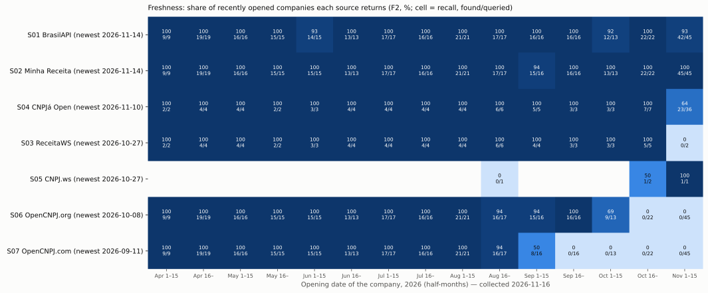

# Freshness and alphanumeric CNPJ support

Português: [REPORT.pt-BR.md](REPORT.pt-BR.md) · Method: [docs/methodology.md](../../docs/methodology.md), section 4 ·
Numbers: [summary.json](../summary.json) (`freshness` of each API and `freshness_meta`)

> **Exploratory test.** 346 lookups of synthetic head-office CNPJs (343 distinct CNPJs), collected
> on 2026-11-17, 02:53–04:30 UTC. It answers "if a company was opened recently, does the API already
> return it?".

## Question
- **RQ6.** If a company was opened this month, or this week, does each free API already return it?
  How far behind the registry is each API?
- **RQ7.** Does each API accept the alphanumeric CNPJ format issued since July 2026?

## Design
1. CNPJ base numbers (first 8 digits) are issued in increasing order. In the official 2026-11
   monthly release, the median base number of companies opened in January 2026 is 64.5 million;
   that of companies opened in October 2026, 69.7 million.
2. Base numbers were drawn uniformly between 66.0 and 70.4 million, which covers roughly April to
   November 2026, in strata of 200,000. A denser sample covered 69.95–70.25 million, the last weeks
   before the release.
3. For each base number, the head-office CNPJ (`/0001` plus check digits) was built and sent to
   every API.
4. A CNPJ counts as existing when at least one API returns it. 298 of the 343 distinct CNPJs
   existed; the rest are numbers not yet used. The opening date is the value given by the majority
   of the APIs that return the CNPJ.
5. Recall is the share of existing companies the API returned, per half-month of opening date.
6. The slow APIs (S03, S04, S05) ran a 66-CNPJ subset with the same strata. S05 ran only its 12
   newest CNPJs (see Deviations).

APIs do not invent CNPJs, so a company that no API returns is invisible to this design. The newest
data of any API is bounded by the official release: extracted on Saturday 2026-11-14 and published
on 2026-11-16. The official files are in folder `2026-11/` of the
[Receita Federal open-data share](https://arquivos.receitafederal.gov.br/index.php/s/YggdBLfdninEJX9).

## Results

| API | Newest opening date returned | Companies opened 2026-10-16 to 2026-11-14 returned | Declared record age (p50) |
|---|---|---|---|
| S02 Minha Receita | 2026-11-14 | 67 of 67 (100%) | — |
| S01 BrasilAPI | 2026-11-14 | 64 of 67 (96%)¹ | — |
| S04 CNPJá Open | 2026-11-10 | 30 of 43 (70%)² | 38 days |
| S03 ReceitaWS | 2026-10-27 | 5 of 7 (71%)³ | 35 days |
| S06 OpenCNPJ.org | 2026-10-08 | 0 of 67 (0%) | 15 days |
| S07 OpenCNPJ.com | 2026-09-11 | 0 of 67 (0%) | — |
| S05 CNPJ.ws | 2026-10-27⁴ | 2 of 3 (inconclusive)⁴ | 38 days |

"—": the API does not expose a per-record update date.

1. The 3 misses were stale cached 404 answers. All 107 frontier CNPJs that S01 and S02 had not
   returned were returned in punctuated form (run `frrt-fmt`).
2. The other 13 answered **HTTP 402** `recently founded offices only available in commercial api`.
3. ReceitaWS answers `"not in cache"` for CNPJs it has never fetched. The free tier serves only its
   own cache.
4. S05 was degraded: 7 of its 12 newest CNPJs ended in HTTP 500/504 or timeout. The newest date in
   the API's own records is 2026-10-27. It also returned a company opened on 2026-11-06 (date given
   by the other APIs) whose record had no opening date.

### Findings
1. **No free API is more recent than the monthly Receita Federal release.**
   - No API returned a company opened after 2026-11-14, the extraction date of the latest release.
   - A company opened this week will appear around mid-December 2026 at the earliest. The next
     extraction is on the 2nd Saturday of December, and the files are published 1–3 days later.
2. **Minha Receita (and BrasilAPI, through it) had the 2026-11 release online two days after
   publication.**
   - S02 returned every existing company in every half-month (100% recall).
3. **OpenCNPJ.org is one release behind.**
   - Its `/info` endpoint reports `source_snapshot_month: 2026-10`, loaded on 2026-11-01.
   - It returned 9 of 13 companies opened between 2026-10-01 and 2026-10-15 and none after that.
4. **OpenCNPJ.com is about two months behind.**
   - It returned 8 of 16 companies opened between 2026-09-01 and 2026-09-15 and none after 2026-09-15.
5. **CNPJá Open withholds part of the newest companies on its free tier (HTTP 402).**
   - Its records declare an update age of 38 days (p50), within the 45-day guarantee it advertises.
6. **ReceitaWS serves only what it has cached.**
   - Older companies were returned. New CNPJs that nobody had queried before answered `not in cache`.
7. **Declared record age.** ReceitaWS, CNPJá, CNPJ.ws and OpenCNPJ.org expose an "updated at" stamp
   per record:
   - most CNPJá and CNPJ.ws records were stamped 2026-10-09/10, close to the October release;
   - OpenCNPJ.org stamps its load date, 2026-11-01.

## Alphanumeric CNPJ (RQ7)
Probe: the official example `12.ABC.345/01DE-35`, 9 valid synthetic alphanumeric CNPJs, one existing
numeric CNPJ and the same CNPJ with a wrong check digit.

| API | Wrong check digit | Valid alphanumeric | Conclusion |
|---|---|---|---|
| S01 BrasilAPI | HTTP 400 "inválido" | HTTP 404 "12.ABC.345/01DE-35 não encontrado" | accepts and validates |
| S02 Minha Receita | HTTP 400 | HTTP 404 | accepts and validates |
| S03 ReceitaWS | HTTP 400 "CNPJ inválido" | HTTP 200 with `"status": "ERROR"` (ReceitaWS errors arrive with HTTP 200) | accepts and validates |
| S04 CNPJá Open | HTTP 400 | HTTP 404 "tax id not registered" | accepts and validates |
| S05 CNPJ.ws | HTTP 400 "CNPJ inválido" | HTTP 404 | accepts and validates |
| S06 OpenCNPJ.org | HTTP 404 | HTTP 404 | no input validation |
| S07 OpenCNPJ.com | HTTP 400 "CNPJ inválido" | HTTP 404 | accepts and validates |

There is only one real alphanumeric CNPJ in the 2026-11 release: `00.000.000/E08G-12`, a branch
registered on 2026-07-31. Format handling could therefore be tested only with valid synthetic CNPJs,
not with real alphanumeric companies.

## Deviations
- S03 and S04 ran the 66-CNPJ subset; S04 also ran the 60-CNPJ near-frontier sample.
- S05 answered about 0.5 CNPJ per minute and was limited to the 12 CNPJs of the four newest strata.
- The first frontier runs of S03, S04 and S05 were interrupted and are excluded (status
  `interrupted`).

## Limitations
- Existence is defined by the APIs themselves. A company present in the registry but returned by
  none of them would be missed. Since S02 matches the latest release, this affects only companies
  opened after 2026-11-14.
- With 13–45 companies per half-month, recall differences smaller than about 15 percentage points
  are not significant.
- New alphanumeric base numbers are not sequential, so this frontier design covers numeric base
  numbers only.

## Evidence
The numbers on this page are in [summary.json](../summary.json) (`freshness` of each API and
`freshness_meta`). The frontier and alphanumeric samples contain no private data and can be rebuilt
exactly with steps 32 and 33 and seed 20261116; see [reproduce.md](../../docs/reproduce.md).
Per-request evidence is not published.
