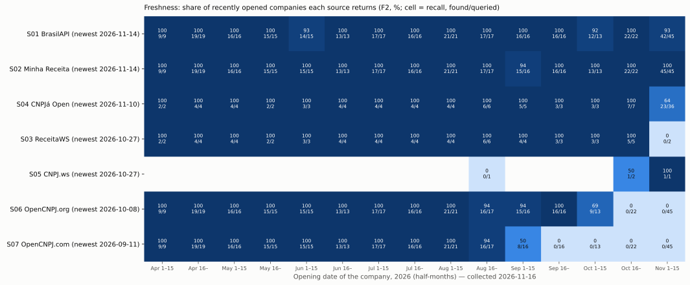

# Frescor e suporte ao CNPJ alfanumérico

English: [REPORT.md](REPORT.md) · Método: [docs/pt-BR/methodology.md](../../docs/pt-BR/methodology.md), §4 ·
Números: [summary.json](../summary.json) (`freshness` de cada API e `freshness_meta`)

> **Teste exploratório.** 346 consultas de CNPJs sintéticos de matriz (343 CNPJs distintos),
> coletadas em 17/11/2026, 02:53–04:30 UTC. Responde "se uma empresa foi aberta recentemente, a API
> já a retorna?".

## Pergunta
- **RQ6.** Se uma empresa foi aberta neste mês, ou nesta semana, cada API gratuita já a retorna?
  Quanto cada API está atrasada em relação ao cadastro?
- **RQ7.** Cada API aceita o formato alfanumérico de CNPJ, emitido desde julho de 2026?

## Desenho
1. Os números-base de CNPJ (8 primeiros dígitos) são emitidos em ordem crescente. Na base mensal
   oficial de 2026-11, o número-base mediano das empresas abertas em janeiro de 2026 é 64,5 milhões;
   o das abertas em outubro de 2026, 69,7 milhões.
2. Os números-base foram sorteados de forma uniforme entre 66,0 e 70,4 milhões, o que cobre
   aproximadamente abril a novembro de 2026, em estratos de 200.000. Uma amostra mais densa cobriu
   69,95–70,25 milhões, as últimas semanas antes da publicação.
3. Para cada número-base, foi montado o CNPJ da matriz (`/0001` mais dígitos verificadores) e
   enviado a todas as APIs.
4. Um CNPJ é considerado existente quando pelo menos uma API o retorna. 298 dos 343 CNPJs distintos
   existiam; os demais são números ainda não usados. A data de abertura é o valor informado pela
   maioria das APIs que retornam o CNPJ.
5. Recall é a proporção de empresas existentes que a API retornou, por quinzena de data de abertura.
6. As APIs lentas (S03, S04, S05) rodaram um subconjunto de 66 CNPJs com os mesmos estratos. A S05
   rodou só seus 12 CNPJs mais recentes (ver Desvios).

As APIs não inventam CNPJs; portanto, uma empresa que nenhuma API retorna fica invisível para este
desenho. O dado mais recente de qualquer API é limitado pela publicação oficial: extraída no sábado,
14/11/2026, e publicada em 16/11/2026. Os arquivos oficiais estão na pasta `2026-11/` do
[compartilhamento de dados abertos da Receita Federal](https://arquivos.receitafederal.gov.br/index.php/s/YggdBLfdninEJX9).

## Resultados

| API | Data de abertura mais recente retornada | Empresas abertas de 16/10/2026 a 14/11/2026 retornadas | Idade declarada do registro (p50) |
|---|---|---|---|
| S02 Minha Receita | 14/11/2026 | 67 de 67 (100%) | — |
| S01 BrasilAPI | 14/11/2026 | 64 de 67 (96%)¹ | — |
| S04 CNPJá Open | 10/11/2026 | 30 de 43 (70%)² | 38 dias |
| S03 ReceitaWS | 27/10/2026 | 5 de 7 (71%)³ | 35 dias |
| S06 OpenCNPJ.org | 08/10/2026 | 0 de 67 (0%) | 15 dias |
| S07 OpenCNPJ.com | 11/09/2026 | 0 de 67 (0%) | — |
| S05 CNPJ.ws | 27/10/2026⁴ | 2 de 3 (inconclusivo)⁴ | 38 dias |

"—": a API não expõe data de atualização por registro.

1. As 3 falhas foram respostas 404 antigas em cache. Todos os 107 CNPJs de fronteira que S01 e S02
   não tinham retornado foram retornados na forma pontuada (execução `frrt-fmt`).
2. As outras 13 responderam **HTTP 402** `recently founded offices only available in commercial api`.
3. A ReceitaWS responde `"not in cache"` para CNPJs que nunca buscou. O plano gratuito serve só o
   próprio cache.
4. A S05 estava degradada: 7 de seus 12 CNPJs mais recentes terminaram em HTTP 500/504 ou tempo
   esgotado. A data mais recente nos registros da própria API é 27/10/2026. Ela também retornou uma
   empresa aberta em 06/11/2026 (data informada pelas outras APIs), cujo registro não trazia data de
   abertura.

### Constatações
1. **Nenhuma API gratuita é mais recente que a base mensal da Receita Federal.**
   - Nenhuma API retornou empresa aberta depois de 14/11/2026, data de extração da publicação mais
     recente.
   - Uma empresa aberta nesta semana aparecerá, no mínimo, por volta de meados de dezembro de 2026.
     A próxima extração ocorre no 2º sábado de dezembro, e os arquivos são publicados 1–3 dias depois.
2. **A Minha Receita (e a BrasilAPI, por meio dela) estava com a base de 2026-11 no ar dois dias
   depois da publicação.**
   - A S02 retornou todas as empresas existentes em todas as quinzenas (recall de 100%).
3. **A OpenCNPJ.org está uma publicação atrás.**
   - O endpoint `/info` informa `source_snapshot_month: 2026-10`, carregada em 01/11/2026.
   - Retornou 9 de 13 empresas abertas entre 01/10/2026 e 15/10/2026 e nenhuma depois disso.
4. **A OpenCNPJ.com está cerca de dois meses atrás.**
   - Retornou 8 de 16 empresas abertas entre 01/09/2026 e 15/09/2026 e nenhuma depois de 15/09/2026.
5. **A CNPJá Open retém no plano gratuito parte das empresas mais recentes (HTTP 402).**
   - Seus registros declaram atualização de 38 dias (p50), dentro da garantia de 45 dias que anuncia.
6. **A ReceitaWS serve só o que tem em cache.**
   - Empresas mais antigas foram retornadas. CNPJs novos que ninguém tinha consultado antes
     responderam `not in cache`.
7. **Idade declarada do registro.** ReceitaWS, CNPJá, CNPJ.ws e OpenCNPJ.org expõem um carimbo
   "atualizado em" por registro:
   - a maioria dos registros da CNPJá e da CNPJ.ws tinha carimbo de 09–10/10/2026, próximo da base
     de outubro;
   - a OpenCNPJ.org carimba a data de carga, 01/11/2026.

## CNPJ alfanumérico (RQ7)
Sondagem: o exemplo oficial `12.ABC.345/01DE-35`, 9 CNPJs alfanuméricos sintéticos válidos, um CNPJ
numérico existente e o mesmo CNPJ com dígito verificador errado.

| API | Dígito verificador errado | Alfanumérico válido | Conclusão |
|---|---|---|---|
| S01 BrasilAPI | HTTP 400 "inválido" | HTTP 404 "12.ABC.345/01DE-35 não encontrado" | aceita e valida |
| S02 Minha Receita | HTTP 400 | HTTP 404 | aceita e valida |
| S03 ReceitaWS | HTTP 400 "CNPJ inválido" | HTTP 200 com `"status": "ERROR"` (erros da ReceitaWS chegam com HTTP 200) | aceita e valida |
| S04 CNPJá Open | HTTP 400 | HTTP 404 "tax id not registered" | aceita e valida |
| S05 CNPJ.ws | HTTP 400 "CNPJ inválido" | HTTP 404 | aceita e valida |
| S06 OpenCNPJ.org | HTTP 404 | HTTP 404 | não valida a entrada |
| S07 OpenCNPJ.com | HTTP 400 "CNPJ inválido" | HTTP 404 | aceita e valida |

Existe só um CNPJ alfanumérico real na base de 2026-11: `00.000.000/E08G-12`, uma filial registrada
em 31/07/2026. Por isso o tratamento do formato pôde ser testado apenas com CNPJs sintéticos
válidos, não com empresas alfanuméricas reais.

## Desvios
- S03 e S04 rodaram o subconjunto de 66 CNPJs; a S04 também rodou a amostra de 60 CNPJs próxima da
  fronteira.
- A S05 respondia cerca de 0,5 CNPJ por minuto e foi limitada aos 12 CNPJs dos quatro estratos mais
  recentes.
- As primeiras execuções de fronteira de S03, S04 e S05 foram interrompidas e estão excluídas
  (situação `interrupted`).

## Limitações
- A existência é definida pelas próprias APIs. Uma empresa presente no cadastro, mas não retornada
  por nenhuma, ficaria de fora. Como a S02 equivale à publicação mais recente, isso afeta apenas
  empresas abertas depois de 14/11/2026.
- Com 13–45 empresas por quinzena, diferenças de recall menores que cerca de 15 pontos percentuais
  não são significativas.
- Os novos números-base alfanuméricos não são sequenciais; por isso este desenho de fronteira cobre
  só números-base numéricos.

## Evidência
Os números desta página estão em [summary.json](../summary.json) (`freshness` de cada API e
`freshness_meta`). As amostras de fronteira e alfanumérica não contêm dados privados e podem ser
reconstruídas exatamente com os passos 32 e 33 e a semente 20261116; ver
[reproduce.md](../../docs/pt-BR/reproduce.md). A evidência por requisição não é publicada.
