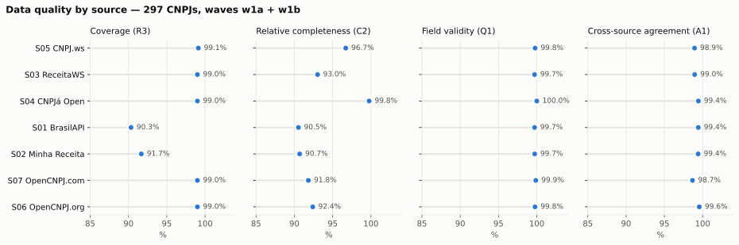
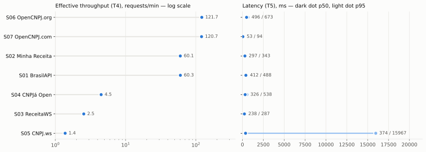
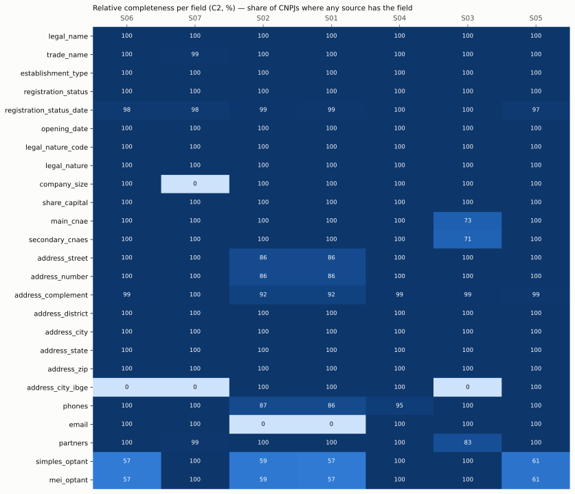

# wave1 — data quality

Sample `SMP-20261116-n1100-r20261116`, waves w1a, w1b; 297 CNPJs with records. Generated 2026-11-17 03:06 UTC. Aggregates only.

| Source | QI | R3 coverage | C2 completeness | Q1 validity | A1 agreement | T4 rpm | p50 ms | p95 ms | T6 429 share | Outcomes |
|---|---|---|---|---|---|---|---|---|---|---|
| S06 OpenCNPJ.org | 0.9772 | 99.0% | 92.4% | 99.8% | 99.6% | 121.66 | 496 | 673 | 0.0% | {'found': 297, 'not_found': 3} |
| S07 OpenCNPJ.com | 0.974 | 99.0% | 91.8% | 99.9% | 98.7% | 120.69 | 53 | 94 | 0.0% | {'found': 297, 'not_found': 3} |
| S02 Minha Receita | 0.9385 | 91.7% | 90.7% | 99.7% | 99.4% | 60.14 | 297 | 343 | 0.0% | {'found': 275, 'not_found': 25} |
| S01 BrasilAPI | 0.9347 | 90.3% | 90.5% | 99.7% | 99.4% | 60.27 | 412 | 488 | 0.0% | {'found': 271, 'not_found': 29} |
| S04 CNPJá Open | 0.9221 | 99.0% | 99.8% | 100.0% | 99.4% | 4.49 | 326 | 538 | 10.7% | {'found': 297, 'not_found': 3} |
| S03 ReceitaWS | 0.891 | 99.0% | 93.0% | 99.7% | 99.0% | 2.54 | 238 | 287 | 16.0% | {'found': 297, 'not_found': 3} |
| S05 CNPJ.ws | 0.887 | 99.1% | 96.7% | 99.8% | 98.9% | 1.38 | 374 | 15967 | 11.0% | {'found': 224, 'not_found': 2, 'server_error': 25, 'timeout': 7} |

Agreement with the internal reference (A2, not ground truth):

| Source | legal_name | address_state | address_city | address_zip | address_city_ibge |
|---|---|---|---|---|---|
| S06 | 69.0% | 97.4% | 92.4% | 67.9% | — |
| S07 | 69.4% | 97.4% | 92.4% | 67.9% | — |
| S02 | 69.5% | 98.5% | 92.9% | 70.8% | 97.5% |
| S01 | 68.3% | 97.2% | 91.7% | 68.8% | 95.2% |
| S04 | 69.0% | 97.4% | 92.4% | 67.9% | 95.7% |
| S03 | 69.0% | 97.4% | 92.4% | 67.9% | — |
| S05 | 69.6% | 96.3% | 92.9% | 64.1% | 97.0% |
