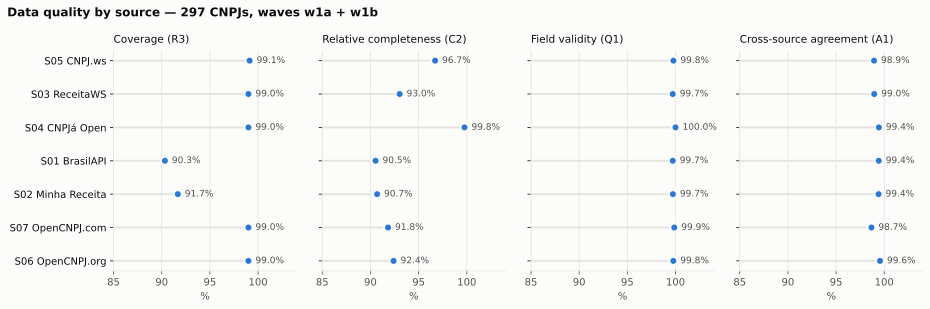
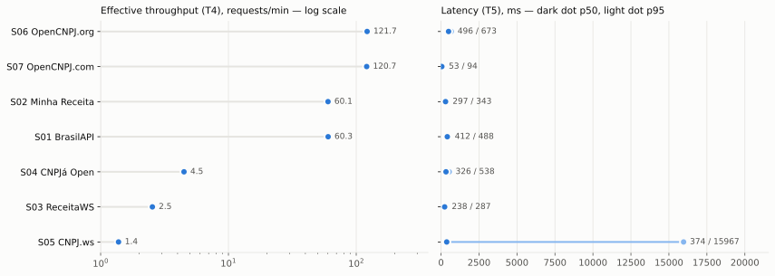
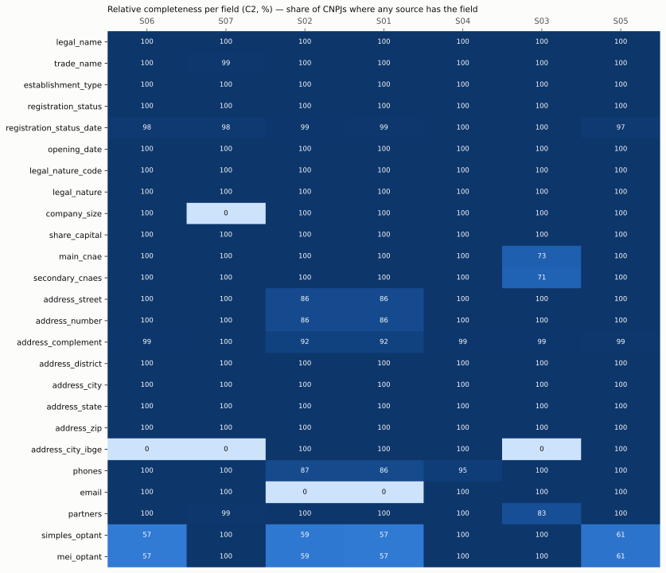

# Wave 1: data quality at each API's pace

Português: [REPORT.pt-BR.md](REPORT.pt-BR.md) · Method: [docs/methodology.md](../../docs/methodology.md) ·
Table of every attribute: [DATASHEET.md](DATASHEET.md) · Numbers: [summary.json](../summary.json) (`wave1` of each API)

> **Exploratory test.** 300 CNPJs, one collection window (2026-11-16 23:55 to 2026-11-17 03:00 UTC),
> one client. It answers "what each free API returned for the same companies that night", not
> "which API is always correct".

## Question
For the same 300 real CNPJs, how often does each API return the company (RQ1)? Which fields does it
fill (RQ2)? Are the values well formed (RQ3), and do they agree with the other APIs (RQ4)? What
throughput does it sustain within its free limit (RQ5)?

## Setup
- **Sample:** the first 300 CNPJs of sample `SMP-20261116-n1100-r20261116`, drawn by simple random
  sampling from 35,702 valid CNPJs in a private reference registry. 297 of the 300 exist (returned
  by at least one API); 85% of them are head offices.
- **Collection:** the 7 APIs queried in parallel. Each API gets one request at a time, at the pace
  of its limit: 60 req/min when no limit is known, 3–5 req/min for S03, S04 and S05. Up to 2 retries
  for HTTP 429, HTTP 5xx or timeout.
- **Evaluation:** every answer is converted to 25 common fields. A value is compared with the
  majority of the other APIs that have the field (at least 3).

## Results

| API | Coverage (95% CI) | Relative completeness | Validity | Agreement | Effective CNPJs/min | Latency p50 / p95 (ms) |
|---|---|---|---|---|---|---|
| S01 BrasilAPI | 90.3% (86.5–93.2)¹ | 90.5% | 99.7% | 99.4% | 60.3 | 412 / 488 |
| S02 Minha Receita | 91.7% (88.0–94.3)¹ | 90.7% | 99.7% | 99.4% | 60.1 | 297 / 343 |
| S03 ReceitaWS | 99.0% (97.1–99.7) | 93.0% | 99.7% | 99.0% | 2.5 | 238 / 287 |
| S04 CNPJá Open | 99.0% (97.1–99.7) | 99.8% | 100.0% | 99.4% | 4.5 | 326 / 538 |
| S05 CNPJ.ws | 99.1% (96.8–99.8)² | 96.7% | 99.8% | 98.9% | 1.4 | 374 / 15,967 |
| S06 OpenCNPJ.org | 99.0% (97.1–99.7) | 92.4% | 99.8% | 99.6% | 121.7 | 496 / 673 |
| S07 OpenCNPJ.com | 99.0% (97.1–99.7) | 91.8% | 99.9% | 98.7% | 120.7 | 53 / 94 |

n = 300 CNPJs per API, except S05 (note 2). 95% CI = 95% Wilson confidence interval.

1. Includes 404s served from a stale cache; 100% after the retest in punctuated form (finding 1).
2. Computed over the 226 CNPJs with a conclusive answer. S05 closed 258 of 300 CNPJs; of these,
   32 (12.4%) ended in HTTP 500, HTTP 504 or timeout, and the run was stopped because the service
   degraded (see Deviations).

### Findings
1. **BrasilAPI and Minha Receita answered stale cached 404s for 7–9% of the existing companies.**
   - S01 answered 404 for 26 (8.8%) and S02 for 22 (7.4%) of the 297 companies that exist.
   - A plain retest about 3 hours later answered 404 again for all of them. The S02 answers carried
     `cf-cache-status: HIT`, i.e. they came from the CDN cache (run `rt3`).
   - Requested in punctuated form (`12.345.678%2F0001-95`, a different URL and therefore outside
     that cache entry), **all 42 were returned** (runs `rt1` to `rt3`).
   - The data exist; those 404s were created earlier (for example during outages or reloads at the
     origin) and the CDN keeps them for up to 5 days. BrasilAPI forwards the bare CNPJ to Minha
     Receita from another region, where the CDN holds different entries; that is why the two
     affected sets share only 9 CNPJs.
   - Corporations (legal natures 2046 and 2054) are 26% of the affected companies and 8% of the
     others (Fisher's exact test, p = 0.002). This is consistent with frequently queried companies
     having been cached during an outage; the cause was not determined.
   - Coverage after the retest: 100% for both. The table keeps the first-pass value, because that is
     what a client gets without repeating the lookup in punctuated form.
2. **BrasilAPI and Minha Receita round share capital above R$ 16,777,216.**
   - Above 16,777,216 (2²⁴), 26 of 39 values differ from the other APIs; for example
     4,443,409,696.10 is returned as 4,443,410,000. Below that threshold, 0 of 236 differ.
   - This is the precision limit of a 32-bit floating-point number; treat these values as
     approximate.
3. **Field gaps per API** (share of records found; full table in [DATASHEET.md](DATASHEET.md)):
   - S01 and S02 never return an e-mail address and lack street and number in 14% of records.
   - S03 lacks the main CNAE in 27% and the partner list in 17% of the records where other APIs
     have them.
   - S07 never returns company size.
   - Only S01, S02, S04 and S05 return the IBGE municipality code.
   - S04 has the highest relative completeness (99.8%); its only relevant gap is phones (5%).
4. **Simples Nacional and MEI flags.** S01, S02, S05 and S06 fill them in 57–61% of records; S03,
   S04 and S07 in 100%.
5. **Values almost always agree.** Mean agreement is ≥ 98.7% and mean validity ≥ 99.7% for every
   API. Disagreements concentrate in three places:
   - phones: S07 returns only the first number, and S03 also includes the fax number;
   - partners: 79% agreement for S05, against 95–98% for the others;
   - the share-capital rounding of finding 2.

   None of the 7 APIs produced text with broken encoding. Head office/branch and IBGE/state
   consistency is 100% where applicable.
6. **Rate limits.**
   - S03, S04 and S05 answered HTTP 429 to 16.0%, 10.7% and 11.0% of attempts even at the pace of
     their nominal limit (3, 5 and 3 req/min). In practice they delivered 1.4–4.5 CNPJs per minute.
   - S01, S02, S06 and S07 sent no HTTP 429, at 60–122 effective requests/min.
7. **Latency.** S07 had the lowest latency (p50 53 ms). S05 had a p95 of 16 s, during its degradation.

## Deviations
S05 was stopped at 158 of 200 CNPJs in the second batch: from about 02:00 UTC the service mostly
answered HTTP 500, HTTP 504 or timed out. Its numbers cover 258 CNPJs closed, 226 with a conclusive
answer. The final status `stopped_degraded` is recorded.

## Limitations
- Most APIs derive from the same monthly Receita Federal open-data release, so agreement means
  consistency, not truth.
- The sample comes from one organisation's registry: it is older and has more corporations than the
  national population of companies.
- With n = 300, differences of a few percentage points fall within the confidence intervals; for
  example, S01 coverage versus S02 coverage.

## Evidence
The numbers on this page are in [summary.json](../summary.json) (`wave1` of each API). The runs used
are listed in [manifest.yaml](../manifest.yaml). Per-request evidence (raw answers and telemetry) is
not published: the sample comes from a private registry, and the CNPJ list would reveal the
companies. To reproduce: [docs/reproduce.md](../../docs/reproduce.md), wave 1 commands, with your own
CNPJ list.
