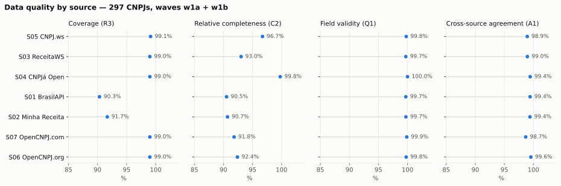
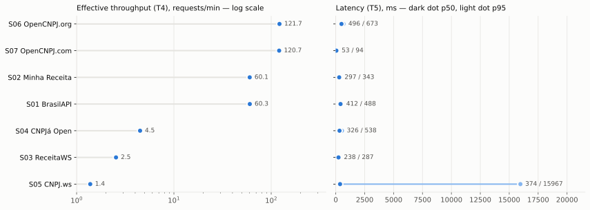
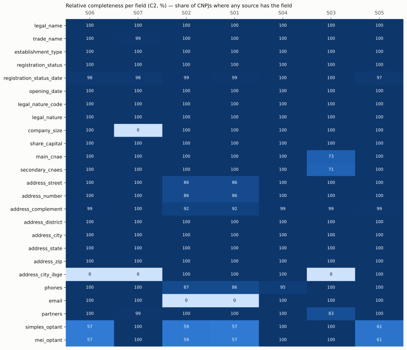

# Onda 1: qualidade dos dados no ritmo de cada API

English: [REPORT.md](REPORT.md) · Método: [docs/pt-BR/methodology.md](../../docs/pt-BR/methodology.md) ·
Tabela de todos os atributos: [DATASHEET.md](DATASHEET.md) · Números: [summary.json](../summary.json) (`wave1` de cada API)

> **Teste exploratório.** 300 CNPJs, uma janela de coleta (16/11/2026 23:55 a 17/11/2026 03:00 UTC),
> um cliente. Responde "o que cada API gratuita retornou para as mesmas empresas naquela noite", e
> não "qual API está correta sempre".

## Pergunta
Para os mesmos 300 CNPJs reais, com que frequência cada API retorna a empresa (RQ1)? Quais campos
ela preenche (RQ2)? Os valores são bem formados (RQ3) e concordam com os das demais APIs (RQ4)?
Que vazão ela sustenta dentro do seu limite gratuito (RQ5)?

## Configuração
- **Amostra:** os primeiros 300 CNPJs da amostra `SMP-20261116-n1100-r20261116`, sorteada por
  amostragem aleatória simples entre 35.702 CNPJs válidos de um cadastro de referência privado.
  297 dos 300 existem (foram retornados por pelo menos uma API); 85% deles são matrizes.
- **Coleta:** as 7 APIs consultadas em paralelo. Cada API recebe uma requisição por vez, no ritmo
  do seu limite: 60 req/min quando não há limite conhecido, 3–5 req/min para S03, S04 e S05. Até 2
  novas tentativas para HTTP 429, HTTP 5xx ou tempo esgotado.
- **Avaliação:** cada resposta é convertida para 25 campos comuns. Um valor é comparado com a
  maioria das demais APIs que têm o campo (pelo menos 3).

## Resultados

| API | Cobertura (IC 95%) | Completude relativa | Validade | Concordância | CNPJs/min efetivos | Latência p50 / p95 (ms) |
|---|---|---|---|---|---|---|
| S01 BrasilAPI | 90,3% (86,5–93,2)¹ | 90,5% | 99,7% | 99,4% | 60,3 | 412 / 488 |
| S02 Minha Receita | 91,7% (88,0–94,3)¹ | 90,7% | 99,7% | 99,4% | 60,1 | 297 / 343 |
| S03 ReceitaWS | 99,0% (97,1–99,7) | 93,0% | 99,7% | 99,0% | 2,5 | 238 / 287 |
| S04 CNPJá Open | 99,0% (97,1–99,7) | 99,8% | 100,0% | 99,4% | 4,5 | 326 / 538 |
| S05 CNPJ.ws | 99,1% (96,8–99,8)² | 96,7% | 99,8% | 98,9% | 1,4 | 374 / 15.967 |
| S06 OpenCNPJ.org | 99,0% (97,1–99,7) | 92,4% | 99,8% | 99,6% | 121,7 | 496 / 673 |
| S07 OpenCNPJ.com | 99,0% (97,1–99,7) | 91,8% | 99,9% | 98,7% | 120,7 | 53 / 94 |

n = 300 CNPJs por API, exceto S05 (nota 2). IC 95% = intervalo de confiança de Wilson de 95%.

1. Inclui 404 servidos de cache antigo; 100% depois do reteste na forma pontuada (constatação 1).
2. Calculado sobre os 226 CNPJs com resposta conclusiva. A S05 encerrou 258 de 300 CNPJs; destes,
   32 (12,4%) terminaram em HTTP 500, HTTP 504 ou tempo esgotado, e a execução foi interrompida
   porque o serviço degradou (ver Desvios).

### Constatações
1. **BrasilAPI e Minha Receita responderam 404 de cache antigo para 7–9% das empresas existentes.**
   - A S01 respondeu 404 para 26 (8,8%) e a S02 para 22 (7,4%) das 297 empresas que existem.
   - Um reteste simples cerca de 3 horas depois devolveu 404 de novo para todas elas. As respostas
     da S02 traziam `cf-cache-status: HIT`, ou seja, vinham do cache da CDN (execução `rt3`).
   - Pedidas na forma pontuada (`12.345.678%2F0001-95`, uma URL diferente e portanto fora daquela
     entrada de cache), **as 42 foram retornadas** (execuções `rt1` a `rt3`).
   - Os dados existem; esses 404 foram gerados antes (por exemplo, durante quedas ou recargas da
     origem) e a CDN os guarda por até 5 dias. A BrasilAPI repassa o CNPJ sem pontuação à Minha
     Receita a partir de outra região, onde a CDN guarda entradas diferentes; por isso os dois
     conjuntos afetados têm só 9 CNPJs em comum.
   - Sociedades anônimas (naturezas jurídicas 2046 e 2054) são 26% das empresas afetadas e 8% das
     demais (teste exato de Fisher, p = 0,002). Isso é compatível com a hipótese de que empresas
     consultadas com frequência entraram no cache durante uma queda; a causa não foi determinada.
   - Cobertura depois do reteste: 100% para as duas. A tabela mantém o valor da primeira passagem,
     porque é o que um cliente obtém sem repetir a consulta na forma pontuada.
2. **BrasilAPI e Minha Receita arredondam o capital social acima de R$ 16.777.216.**
   - Acima de 16.777.216 (2²⁴), 26 de 39 valores diferem das demais APIs; por exemplo,
     4.443.409.696,10 é retornado como 4.443.410.000. Abaixo desse limiar, 0 de 236 diferem.
   - É o limite de precisão de um número de ponto flutuante de 32 bits; trate esses valores como
     aproximados.
3. **Lacunas de campos por API** (proporção dos registros encontrados; tabela completa em
   [DATASHEET.md](DATASHEET.md)):
   - S01 e S02 nunca retornam e-mail e não trazem logradouro e número em 14% dos registros.
   - A S03 não traz o CNAE principal em 27% e a lista de sócios em 17% dos registros em que outras
     APIs os têm.
   - A S07 nunca retorna o porte da empresa.
   - Só S01, S02, S04 e S05 retornam o código IBGE do município.
   - A S04 tem a maior completude relativa (99,8%); sua única lacuna relevante são os telefones (5%).
4. **Indicadores de Simples Nacional e MEI.** S01, S02, S05 e S06 os preenchem em 57–61% dos
   registros; S03, S04 e S07, em 100%.
5. **Os valores quase sempre concordam.** A concordância média é ≥ 98,7% e a validade média é
   ≥ 99,7% em todas as APIs. As discordâncias se concentram em três pontos:
   - telefones: a S07 retorna só o primeiro número, e a S03 inclui também o fax;
   - sócios: 79% de concordância na S05, contra 95–98% nas demais;
   - o arredondamento do capital social da constatação 2.

   Nenhuma das 7 APIs produziu texto com codificação corrompida. A consistência matriz/filial e
   IBGE/UF é de 100% onde se aplica.
6. **Limites de requisição.**
   - S03, S04 e S05 responderam HTTP 429 a 16,0%, 10,7% e 11,0% das tentativas mesmo no ritmo do
     limite nominal (3, 5 e 3 req/min). Na prática entregaram 1,4–4,5 CNPJs por minuto.
   - S01, S02, S06 e S07 não enviaram nenhum HTTP 429, a 60–122 requisições/min efetivas.
7. **Latência.** A S07 teve a menor latência (p50 53 ms). A S05 teve p95 de 16 s, durante a degradação.

## Desvios
A S05 foi interrompida em 158 de 200 CNPJs no segundo lote: a partir de cerca de 02:00 UTC o serviço
respondeu majoritariamente HTTP 500, HTTP 504 ou esgotou o tempo. Seus números cobrem 258 CNPJs
encerrados, 226 com resposta conclusiva. A situação final `stopped_degraded` está registrada.

## Limitações
- A maioria das APIs deriva da mesma publicação mensal de dados abertos da Receita Federal; por isso
  concordância significa consistência, não verdade.
- A amostra vem do cadastro de uma única organização: é mais antiga e tem mais sociedades anônimas
  que o conjunto nacional de empresas.
- Com n = 300, diferenças de poucos pontos percentuais ficam dentro dos intervalos de confiança; por
  exemplo, a cobertura da S01 em relação à da S02.

## Evidência
Os números desta página estão em [summary.json](../summary.json) (`wave1` de cada API). As
execuções usadas estão em [manifest.yaml](../manifest.yaml). A evidência por requisição (respostas
brutas e telemetria) não é publicada: a amostra vem de um cadastro privado, e a lista de CNPJs
revelaria as empresas. Reproduzir: [docs/pt-BR/reproduce.md](../../docs/pt-BR/reproduce.md),
comandos da onda 1, com uma lista própria de CNPJs.
