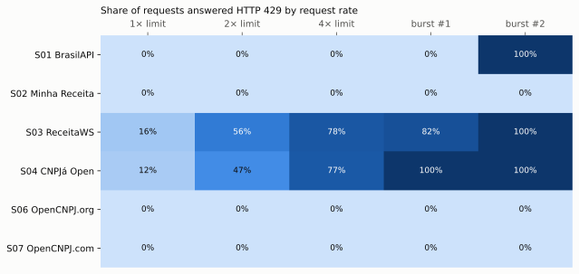
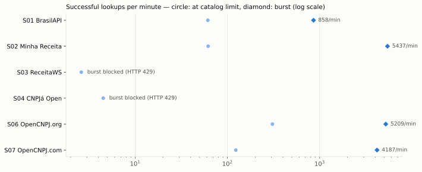

# wave2 — saturation

Samples `SMP-20261117-n196-r20261116-w2` (ramp) and `SMP-20261117-n196-r20261116-w2` (burst, queried twice). Generated 2026-11-17 03:50 UTC. Aggregates only.

| Source | Step | Attempted rpm | Found rpm | 429 share | First 429 at attempt | 429 with Retry-After | Rate-limit headers | Other errors | Run status |
|---|---|---|---|---|---|---|---|---|---|
| S01 | 1× limit | 61.44 | 61.44 | 0.0% | — | — | — | — | finished |
| S01 | 2× limit | 114.59 | 114.59 | 0.0% | — | — | — | — | finished |
| S01 | 4× limit | 189.21 | 183.3 | 0.0% | — | — | — | — | finished |
| S01 | burst #1 | 858.18 | 858.18 | 0.0% | — | — | — | — | finished |
| S01 | burst #2 | 3366.42 | 0.0 | 100.0% | 0 | 0.0% | — | — | stopped_breaker |
| S02 | 1× limit | 61.85 | 61.85 | 0.0% | — | — | — | — | finished |
| S02 | 2× limit | 123.47 | 123.47 | 0.0% | — | — | — | — | finished |
| S02 | 4× limit | 246.89 | 246.89 | 0.0% | — | — | — | — | finished |
| S02 | burst #1 | 5436.75 | 5436.75 | 0.0% | — | — | — | — | finished |
| S02 | burst #2 | 6310.48 | 6310.48 | 0.0% | — | — | — | — | finished |
| S03 | 1× limit | 3.1 | 2.61 | 15.6% | 2 | 0.0% | x-ratelimit-limit, x-ratelimit-remaining | — | finished |
| S03 | 2× limit | 6.19 | 2.71 | 56.2% | 2 | 0.0% | x-ratelimit-limit, x-ratelimit-remaining | — | finished |
| S03 | 4× limit | 12.45 | 2.77 | 77.8% | 0 | 0.0% | x-ratelimit-limit, x-ratelimit-remaining | — | stopped_breaker |
| S03 | burst #1 | 1103.3 | 194.7 | 82.3% | 2 | 0.0% | x-ratelimit-limit, x-ratelimit-remaining | — | stopped_breaker |
| S03 | burst #2 | 1171.35 | 0.0 | 100.0% | 0 | 0.0% | x-ratelimit-limit, x-ratelimit-remaining | — | stopped_breaker |
| S04 | 1× limit | 5.16 | 4.51 | 12.5% | 3 | 0.0% | — | — | finished |
| S04 | 2× limit | 10.31 | 5.48 | 46.9% | 5 | 0.0% | — | — | finished |
| S04 | 4× limit | 21.56 | 4.98 | 76.9% | 3 | 0.0% | — | — | stopped_breaker |
| S04 | burst #1 | 958.23 | 0.0 | 100.0% | 0 | 0.0% | — | — | stopped_breaker |
| S04 | burst #2 | 957.88 | 0.0 | 100.0% | 0 | 0.0% | — | — | stopped_breaker |
| S06 | 1× limit | 307.79 | 307.79 | 0.0% | — | — | — | — | finished |
| S06 | 2× limit | 511.37 | 511.37 | 0.0% | — | — | — | — | finished |
| S06 | 4× limit | 1091.03 | 1091.03 | 0.0% | — | — | — | — | finished |
| S06 | burst #1 | 5209.24 | 5209.24 | 0.0% | — | — | — | — | finished |
| S06 | burst #2 | 5077.43 | 5077.43 | 0.0% | — | — | — | — | finished |
| S07 | 1× limit | 123.37 | 123.37 | 0.0% | — | — | — | — | finished |
| S07 | 2× limit | 245.98 | 245.98 | 0.0% | — | — | — | — | finished |
| S07 | 4× limit | 487.06 | 487.06 | 0.0% | — | — | — | — | finished |
| S07 | burst #1 | 4187.02 | 4187.02 | 0.0% | — | — | — | — | finished |
| S07 | burst #2 | 4718.09 | 4718.09 | 0.0% | — | — | — | — | finished |

Repeat consistency (burst #1 vs #2, same CNPJs):

| Source | Found in both | Identical record | p50 latency ratio #2/#1 |
|---|---|---|---|
| S01 | 0 | — | None |
| S02 | 100 | 100.0% | 0.998 |
| S03 | 0 | — | None |
| S04 | 0 | — | None |
| S06 | 100 | 100.0% | 1.028 |
| S07 | 100 | 100.0% | 0.912 |
