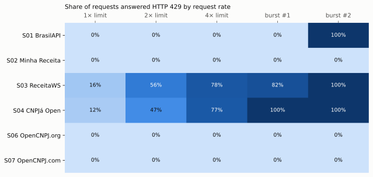
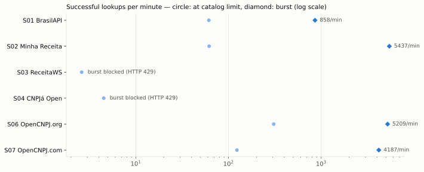

# Wave 2: behaviour above the rate limit

Português: [REPORT.pt-BR.md](REPORT.pt-BR.md) · Method: [docs/methodology.md](../../docs/methodology.md) ·
Numbers: [summary.json](../summary.json) (`wave2` of each API) · Generated table: [README.md](README.md)

> **Exploratory test.** 196 CNPJs that every API had returned in wave 1, collected on 2026-11-17,
> 03:03–04:15 UTC, from one client and one IP. It answers "what happens when a client goes over the
> free limit", so that a client can be configured. It does not encourage exceeding limits.

## Question
What happens when a client goes over an API limit (RQ5)? When does HTTP 429 appear, does the API
say when to retry, and how many records per minute still get through? Does querying the same CNPJs
twice return the same record?

## Design
- **Ramp.** 96 CNPJs in three blocks of 32, at 1×, 2× and 4× the pace used in wave 1 (60 req/min
  when no limit is known; S03 3, S04 5, S06 300, S07 120).
- **Bursts.** The other 100 CNPJs, without pacing and with 4 concurrent requests, sent twice
  (burst #1 and #2).
- **Safety rules.** No retries. A run stops after 10 consecutive HTTP 429 answers (status
  `stopped_breaker` in the data). At most 300 requests per API.
- **Order.** Fast APIs first, then S03 and S04, one API at a time per provider. S05 was not tested:
  the service was answering HTTP 500/504 at the time (see wave 1).

## Results

| API | 1× | 2× | 4× | Burst #1 | Burst #2 | Retry-After on 429 | Records/min, best sustained run |
|---|---|---|---|---|---|---|---|
| S01 BrasilAPI | 0.0% @ 61 | 0.0% @ 115 | 0.0% @ 189 | 0.0% @ 858 | **100% @ 3,366 (stopped)** | no | 858 |
| S02 Minha Receita | 0.0% @ 62 | 0.0% @ 123 | 0.0% @ 247 | 0.0% @ 5,437 | 0.0% @ 6,310 | — | 6,310 |
| S03 ReceitaWS | 15.6% @ 3 | 56.2% @ 6 | 77.8% @ 12 (stopped) | 82.3% @ 1,103 (stopped after 17 requests) | 100% @ 1,171 (stopped) | no | 2.8 |
| S04 CNPJá Open | 12.5% @ 5 | 46.9% @ 10 | 76.9% @ 22 (stopped) | 100% @ 958 (stopped) | 100% @ 958 (stopped) | no | 5.5 |
| S06 OpenCNPJ.org | 0.0% @ 308 | 0.0% @ 511 | 0.0% @ 1,091 | 0.0% @ 5,209 | 0.0% @ 5,077 | — | 5,209 |
| S07 OpenCNPJ.com | 0.0% @ 123 | 0.0% @ 246 | 0.0% @ 487 | 0.0% @ 4,187 | 0.0% @ 4,718 | — | 4,718 |

Cells: share of attempts answered HTTP 429 @ attempted requests per minute. "Stopped" = the run
reached 10 consecutive HTTP 429 answers and was halted by the safety rule. The last column considers
the ramp runs and the bursts that did not stop; in S03 burst #1, 3 records arrived within a few
seconds before the stop (194.7/min), which is not a sustainable rate.

### Findings
1. **Minha Receita, OpenCNPJ.org and OpenCNPJ.com sent no HTTP 429, even at 4,187–6,310 requests
   per minute.**
   - The p50 latency of found records stayed at 31–46 ms during the bursts. Those CNPJs had been
     queried hours earlier, so the answers probably came from the CDN cache; uncached lookups may be
     slower.
   - The documented OpenCNPJ.com limit is 300 req/min (`X-Ratelimit-Limit: 300`), but it was not
     enforced in these short bursts.
2. **BrasilAPI blocks after a short burst.**
   - The first burst (100 requests, 858 req/min) went through. The second, seconds later, received
     100% HTTP 429, with no `Retry-After` and no rate-limit headers.
3. **CNPJá Open behaves like a quota that refills at about 5 requests per minute.**
   - Above that, excess requests are refused: 46.9% HTTP 429 at 2×, 76.9% at 4×, 100% in the bursts.
   - Records obtained stay between 4.5 and 5.5 per minute, whatever the attempted rate. There is no
     `Retry-After`.
4. **ReceitaWS behaves the same way, at about 3 requests per minute.**
   - HTTP 429 rises from 15.6% at 1× to 77.8% at 4×, while records obtained stay at 2.6–2.8 per
     minute.
   - The 429 answers carry `X-RateLimit-Limit` and `X-RateLimit-Remaining`, but no `Retry-After`.
5. **Repeat consistency.** In both bursts, S02, S06 and S07 returned identical records for the 100
   CNPJs (100%). The ratio of p50 latencies between bursts was 0.91–1.03; there was no measurable
   additional caching effect between one burst and the next.
6. **Practical client settings.**
   - Cap S03 at 3 req/min and S04 at 5 req/min and still expect HTTP 429; wait 60 s after each one.
   - For S01, keep at most about 60 req/min sustained.
   - S02, S06 and S07 accepted well over 1,000 req/min in this test. Their maintainers ask for
     moderation, and S07 documents 300 req/min.

## Limitations
- One IP, a short window and CNPJs mostly already cached: the test does not measure daily quotas or
  blocks that build up over hours.
- CNPJ.ws documents a 1-hour block after more than 360 HTTP 429 answers in an hour; that block was
  not tested.

## Evidence
The numbers on this page are in [summary.json](../summary.json) (`wave2` of each API) and in the
generated table in [README.md](README.md). Per-request evidence is not published (see the
[methodology](../../docs/methodology.md), section 11).
