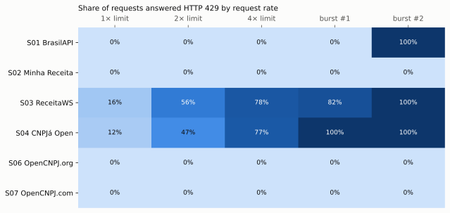
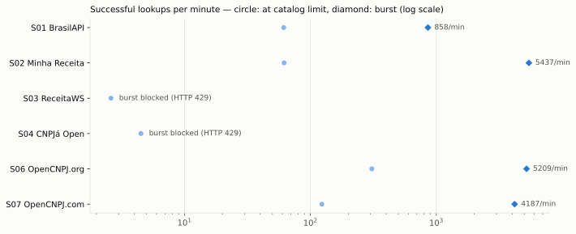

# Onda 2: comportamento acima do limite de requisições

English: [REPORT.md](REPORT.md) · Método: [docs/pt-BR/methodology.md](../../docs/pt-BR/methodology.md) ·
Números: [summary.json](../summary.json) (`wave2` de cada API) · Tabela gerada: [README.md](README.md)

> **Teste exploratório.** 196 CNPJs que todas as APIs haviam retornado na onda 1, coletados em
> 17/11/2026, 03:03–04:15 UTC, a partir de um cliente e um IP. Responde "o que acontece quando o
> cliente passa do limite gratuito", para que um cliente possa ser configurado. Não incentiva
> exceder limites.

## Pergunta
O que acontece quando um cliente passa do limite de uma API (RQ5)? Quando aparece o HTTP 429, a
API informa quando tentar de novo, e quantos registros por minuto ainda passam? Consultar os mesmos
CNPJs duas vezes devolve o mesmo registro?

## Desenho
- **Rampa.** 96 CNPJs em três blocos de 32, a 1×, 2× e 4× o ritmo usado na onda 1 (60 req/min
  quando não há limite conhecido; S03 3, S04 5, S06 300, S07 120).
- **Rajadas.** Os outros 100 CNPJs, sem controle de ritmo e com 4 requisições simultâneas, enviados
  duas vezes (rajada nº 1 e nº 2).
- **Regras de segurança.** Nenhuma nova tentativa. Uma execução para depois de 10 respostas HTTP
  429 seguidas (situação `stopped_breaker` nos dados). No máximo 300 requisições por API.
- **Ordem.** APIs rápidas primeiro, depois S03 e S04, uma API por vez por provedor. A S05 não foi
  testada: o serviço respondia HTTP 500/504 naquele momento (ver onda 1).

## Resultados

| API | 1× | 2× | 4× | Rajada nº 1 | Rajada nº 2 | Retry-After no 429 | Registros/min, melhor execução sustentada |
|---|---|---|---|---|---|---|---|
| S01 BrasilAPI | 0,0% @ 61 | 0,0% @ 115 | 0,0% @ 189 | 0,0% @ 858 | **100% @ 3.366 (parada)** | não | 858 |
| S02 Minha Receita | 0,0% @ 62 | 0,0% @ 123 | 0,0% @ 247 | 0,0% @ 5.437 | 0,0% @ 6.310 | — | 6.310 |
| S03 ReceitaWS | 15,6% @ 3 | 56,2% @ 6 | 77,8% @ 12 (parada) | 82,3% @ 1.103 (parada após 17 requisições) | 100% @ 1.171 (parada) | não | 2,8 |
| S04 CNPJá Open | 12,5% @ 5 | 46,9% @ 10 | 76,9% @ 22 (parada) | 100% @ 958 (parada) | 100% @ 958 (parada) | não | 5,5 |
| S06 OpenCNPJ.org | 0,0% @ 308 | 0,0% @ 511 | 0,0% @ 1.091 | 0,0% @ 5.209 | 0,0% @ 5.077 | — | 5.209 |
| S07 OpenCNPJ.com | 0,0% @ 123 | 0,0% @ 246 | 0,0% @ 487 | 0,0% @ 4.187 | 0,0% @ 4.718 | — | 4.718 |

Células: proporção de tentativas respondidas com HTTP 429 @ requisições tentadas por minuto.
"Parada" = a execução atingiu 10 respostas HTTP 429 seguidas e foi interrompida pela regra de
segurança. A última coluna considera as execuções da rampa e as rajadas que não pararam; na rajada
nº 1 da S03, 3 registros chegaram em poucos segundos antes da parada (194,7/min), o que não
representa um ritmo sustentável.

### Constatações
1. **Minha Receita, OpenCNPJ.org e OpenCNPJ.com não enviaram nenhum HTTP 429, mesmo a
   4.187–6.310 requisições por minuto.**
   - A latência p50 dos registros encontrados ficou em 31–46 ms nas rajadas. Esses CNPJs tinham sido
     consultados horas antes, então as respostas provavelmente vieram do cache da CDN; consultas fora
     do cache podem ser mais lentas.
   - O limite documentado da OpenCNPJ.com é 300 req/min (`X-Ratelimit-Limit: 300`), mas não foi
     aplicado nessas rajadas curtas.
2. **A BrasilAPI bloqueia depois de uma rajada curta.**
   - A primeira rajada (100 requisições, 858 req/min) passou. A segunda, segundos depois, recebeu
     100% de HTTP 429, sem `Retry-After` e sem cabeçalhos de limite.
3. **A CNPJá Open se comporta como uma cota que se renova a cerca de 5 requisições por minuto.**
   - Acima disso, as requisições excedentes são recusadas: 46,9% de HTTP 429 a 2×, 76,9% a 4×,
     100% nas rajadas.
   - Os registros obtidos ficam entre 4,5 e 5,5 por minuto, qualquer que seja o ritmo tentado. Não
     há `Retry-After`.
4. **A ReceitaWS se comporta do mesmo modo, a cerca de 3 requisições por minuto.**
   - O HTTP 429 sobe de 15,6% a 1× para 77,8% a 4×, enquanto os registros obtidos ficam em 2,6–2,8
     por minuto.
   - As respostas 429 trazem `X-RateLimit-Limit` e `X-RateLimit-Remaining`, mas não `Retry-After`.
5. **Consistência na repetição.** Nas duas rajadas, S02, S06 e S07 devolveram registros idênticos
   para os 100 CNPJs (100%). A razão entre as latências p50 das rajadas foi 0,91–1,03; não houve
   efeito de cache adicional mensurável entre uma rajada e outra.
6. **Configuração prática para um cliente.**
   - Limite S03 a 3 req/min e S04 a 5 req/min e, ainda assim, espere HTTP 429; aguarde 60 s depois
     de cada um.
   - Na S01, mantenha no máximo cerca de 60 req/min contínuos.
   - S02, S06 e S07 aceitaram bem mais de 1.000 req/min neste teste. Seus mantenedores pedem
     moderação, e a S07 documenta 300 req/min.

## Limitações
- Um IP, uma janela curta e CNPJs em geral já em cache: o teste não mede cotas diárias nem bloqueios
  que se acumulam ao longo de horas.
- A CNPJ.ws documenta bloqueio de 1 hora depois de mais de 360 respostas HTTP 429 em uma hora; esse
  bloqueio não foi testado.

## Evidência
Os números desta página estão em [summary.json](../summary.json) (`wave2` de cada API) e na tabela
gerada em [README.md](README.md). A evidência por requisição não é publicada (ver
[metodologia](../../docs/pt-BR/methodology.md), §11).
